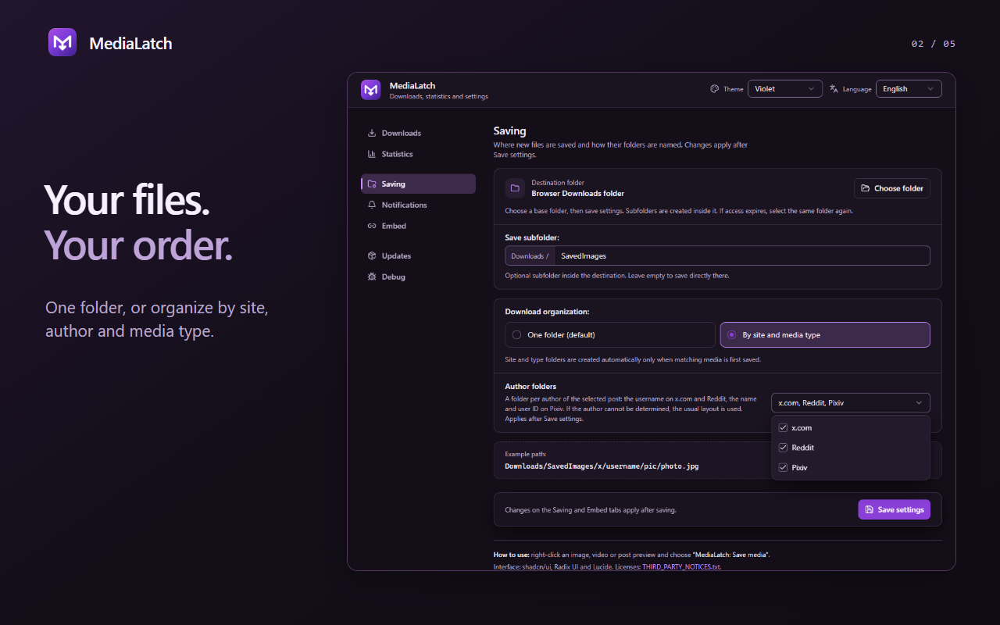
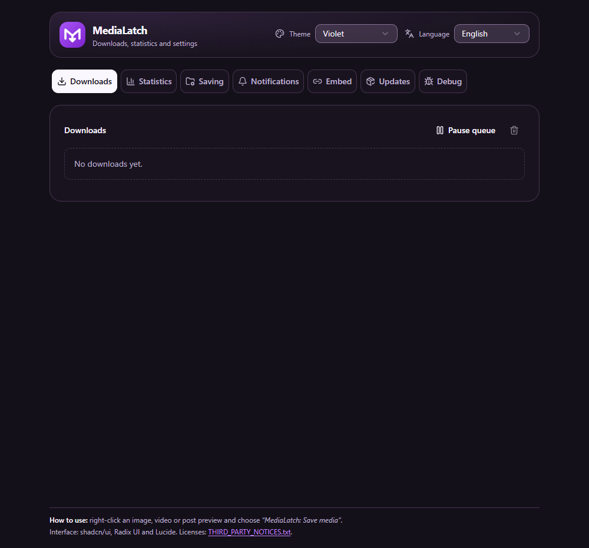
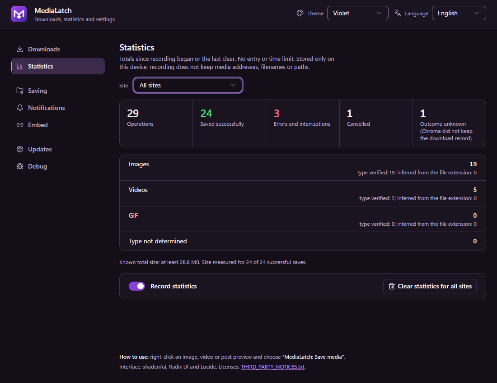
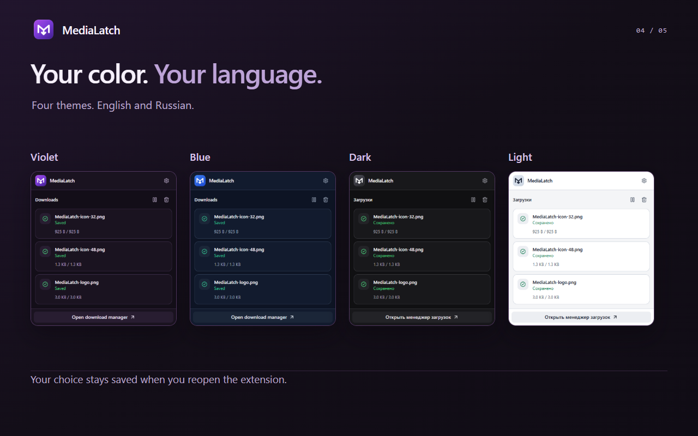

<div align="center">
  
  <h1>MediaLatch</h1>
  <p><i>"Save available originals directly from your browser — images, videos and GIFs, organized your way."</i></p>
  <p>
    <a href="https://github.com/xhthc/MediaLatch/releases/tag/v2.5.6"></a>
    
    
    
    <a href="LICENSE"></a>
  </p>
  <p>
    <a href="https://github.com/xhthc/MediaLatch/releases/tag/v2.5.6"></a>
    
    
  </p>
  <p><a href="README.ru.md">Русский</a> · <a href="#quick-start">Quick start</a> · <a href="#install">Installation</a> · <a href="#roadmap">Roadmap</a> · <a href="docs/PRIVACY.md">Privacy</a></p>
</div>

MediaLatch (formerly Image Saver) saves accessible original images, videos and GIFs directly from your browser. Choose the media you want, follow the save in the download manager and find the file where you expect it. No companion application is needed.

> **Current pre-release: [v2.5.6](https://github.com/xhthc/MediaLatch/releases/tag/v2.5.6).** Fixes VK photo controls, carousels and collages: Save this / Save all stays at the media’s own upper-left corner. These photo flows were user checked in Helium. Full VK video and clip support is planned; original-photo quality remains unverified. [What changed](CHANGELOG.md).

| What you want to do | What MediaLatch offers |
|---|---|
| Save selected media | Context-menu actions and inline controls on supported sites |
| Keep files organized | One folder, site/type folders or optional posting-account folders (X, Reddit, Pixiv, VK, RedGIFs, Instagram, TikTok) |
| Follow each download | Per-file progress, post-batch totals, cancellation, retries and clear errors |
| Make it yours | Violet, Blue, Dark and Light themes; English and Russian |
| Keep records on this device | Opt-in local statistics and Debug; no analytics or automatic report upload |

Tested primarily in Helium on Windows. Coverage is limited to the paths below; site layouts and access rules can change. Firefox support is planned. The user reports that Chrome Web Store 2.5.2 was approved and published, then accidentally unpublished; this GitHub preview does not republish the store listing.

---

## Interface



<details>
<summary>More interface screenshots</summary>

<table>
  <tr>
    <td width="50%"><br><strong>Start in three steps</strong><br>A fresh install opens a short welcome screen once; Continue opens the Saving settings.</td>
    <td width="50%"><br><strong>Follow every download</strong><br>Site groups with separate individual/post lists, per-file progress and Cancel remaining.</td>
  </tr>
  <tr>
    <td width="50%"><br><strong>Choose where files go</strong><br>Destination, optional subfolder, author folders and a live path example.</td>
    <td width="50%"><br><strong>Choose how links are shared</strong><br>A compact grid of four selectors, with floating help beside each platform and no layout shift.</td>
  </tr>
</table>



</details>

The download-manager and link-preview settings captures show v2.5.4 with neutral fixture data in an isolated Chromium profile; they illustrate the UI, not a live provider session. Statistics retain their v2.5.3 captures; welcome, Saving and illustrated cards retain their v2.5.1 captures. Separate export-byte and user-reported browser checks are described below.

---

## Quick start

1. Install the runtime ZIP using the instructions below.
2. Right-click an image, video or supported preview and choose **MediaLatch: Save media**. On X, try **Shift + right-click** if the site intercepts the menu.
3. Track downloads in the popup. **Open download manager** leads to details, cancellation and retrying export from prepared bytes. MediaLatch notices appear on the original page.
4. Open **Saving**, choose a destination and organization, then press **Save settings**. Files default to `Downloads/SavedImages/`.

A fresh install opens a short welcome once. **Continue** opens **Saving**. Folder and preview-link choices apply after **Save settings**; themes, language and notification switches apply immediately.

<details>
<summary>Welcome, saved preferences and error states</summary>

A fresh install opens a separate welcome screen with three short steps. **Continue** remembers it and opens **Saving**; the welcome is shown only for that first install, never after updates or browser restarts, and there is no tutorial button afterwards. Saving and Embed show **Unsaved changes** whenever the form differs from what is stored (also right after a save), saving progress, success or a lasting error; a failed settings read offers **Try again**. Both download managers explain failures in plain language, consistently on the card and in its details, and keep the technical code on a small line.

</details>

---

## Install

1. Download the **runtime ZIP** from [Releases](https://github.com/xhthc/MediaLatch/releases) and extract it. Choose `MediaLatch-2.5.6-*.zip` from the current preview; its filename includes the source commit. GitHub's automatic Source code ZIP contains the development repository.
2. Open `chrome://extensions`, enable **Developer mode**, select **Load unpacked** and choose the folder containing `manifest.json`.
3. After replacing a build, reload the extension **and refresh site tabs**.


Alternatively, clone and load the repository root:

```bash
git clone https://github.com/xhthc/MediaLatch.git
```

To update an unpacked installation, replace the files in its existing folder, then click **Reload** on the browser's extensions page and refresh site tabs. Keep the same folder to retain the extension's identity and settings.

The committed `popup/` pages are ready to use. Node/npm are needed only for development. Unpacked installs update manually; store updates will be a separate distribution path.

---

## Features

The current preview covers the workflows below. Availability depends on the page, media format and your access to the source; see [site coverage](#site-coverage) and [limits](#limits-and-privacy).

### Save the selected media

- Original discovery through site adapters, image links, `srcset`, media attributes and unambiguous CSS backgrounds or overlays.
- Native images/GIFs and accessible MP4/WebM videos. Exact declared URLs, including signatures, are preserved.
- Genuine looping GIFs from confirmed X and Reddit MP4 animations. Animations longer than 30 seconds or exceeding conversion size limits remain source MP4; other conversion failures are reported.
- Shared inline save controls on X, Reddit, Pixiv, RedGIFs and VK. Pixiv offers Save this for the selected original page and Save all for a proven multi-page artwork, including supported feed cards. Other http(s) sites get a generic Save this control for an individual, directly declared image or video file (not blob/MSE, HLS, DASH or DRM players).
- Experimental VK photo saving on vk.ru/vk.com: Save this and Save all for proven complete carousels/collages. Controls keep a constant offset from the media’s own upper-left corner and scroll with it.
- All distinct declared original media from a Pawchive feed preview, including the original cover. Selecting an individual attachment saves that attachment.

### Manage files

- Choose a writable base folder and an optional subfolder. Save everything into one folder or organize by site/type. One Author folders menu enables any combination of x.com, Reddit, Pixiv, VK, RedGIFs, Instagram and TikTok. The folder names the posting account of the selected post (author name plus user ID on Pixiv), not the original artist; an unknown or ambiguous account uses the normal layout. Save results and redacted error reports stay in the manager.
- Show the proven posting account in page notices, popup and full Downloads, including post batches and retries. An account is shown only when the media is evidently the post's own attachment: comments, replies, quotes, header avatars and profile-linked media do not get the post's account; unknown accounts and older records omit the label.
- Show in folder (popup and full Downloads) reveals the exact saved file of a finished browser download, including a renamed "photo (1).jpg". Files written to a chosen folder have no browser download record, so they have no such icon.
- Compact popup with wheel/keyboard scrolling, a translucent custom scrollbar and one clear action for finished records; individual removal and details stay in the full manager.
- Download manager with received/total bytes, speed and approximate remaining time when measurable. Complete files are staged locally before browser export; failed export can retry from retained bytes without another source download.

Both managers group all single and batch downloads by site. A new save reuses and promotes its site group. Inside it, Individual files is separate from compact post cards; finished subgroups start folded and expand with a click or keyboard. Post counts keep saved, failed, cancelled, skipped and remaining items distinct. Cancel remaining stops unfinished work for that post without removing already saved files or cancelling unrelated downloads. Retry updates the same item; only confirmed export counts as saved. Partial Pawchive imports retain their qualifier.

### Settings and diagnostics



- One updating page notice per X/Reddit post batch, multi-page Pixiv artwork or multi-original Pawchive post, using the same counts as the manager. Single saves retain their existing notices; partial Pawchive imports keep their specific error. Closed or navigated tabs cannot display them; results and the failure badge remain in the extension. Success notices can be switched off independently.
- Violet by default, with Blue, Dark and Light themes and matching MediaLatch icons in the interface and toolbar. Saved choices apply across the popup, settings and notices; existing preferences are preserved. Brief animations respect reduced motion.
- Opt-in local statistics with All sites and only recorded services in the selector; Booru boards share one view. Totals and available old history are preserved without inventing historical attribution. Recording and clear apply to every site; clearing never deletes saved files.
- Opt-in local Debug journal with filters, copy/export and clear controls: up to 2,000 events, 1 MiB and 24 hours. Full URLs, tokens, page text and local paths are excluded.
- Supported post-link copying on X, Instagram, TikTok and YouTube Shorts, with optional preview-link hosts. Choose the service per platform; copying a link itself does not contact that service.
- GitHub release checks manually or on opening Updates, at most daily. Downloaded extension code is not installed automatically.

---

## Site coverage

| Source | Current behavior |
|---|---|
| X / Twitter | Selected images/videos, confirmed MP4 animations, inline saving and post batches |
| Reddit | Originals, animations, inline saving; selected finite, unencrypted H.264/AAC Reddit HLS streams assembled into MP4 |
| RedGIFs | Selected clip and same-clip video renditions; inline saving; provider audio recovery where available |
| Pawchive | Declared post originals from previews or individual attachments; common 100-file batch limit, with spaced starts and a rate-limit stop |
| Sankaku | Selected preview/sample to declared same-post original via the context menu in feeds/opened posts; image/video smoke tests reported working in Helium, native GIF test pending |
| Booru boards | Danbooru, Gelbooru/rule34.xxx/safebooru.org and Moebooru boards such as yande.re, Konachan and Sakugabooru: selected preview/post media resolves to the declared same-post, same-file original; access/challenge pages can still prevent saving |
| Zerochan | Selected thumbnail or opened-post media resolves to the declared same-post original; unavailable originals are refused |
| Pixiv | Inline Save this / Save all on supported previews and opened artwork; declared original pages, up to 100 per batch; context-menu preview-all/opened-image-single behavior retained |
| VK (experimental) | Selected loaded photos and proven complete carousel/collage lists, up to 100 files; user checked in Helium. Preserve exact declared URLs. General video/clip support is planned; original-photo quality is not verified. Existing mixed-post progressive-video handling is limited and experimental. |
| Other sites | Generic discovery plus existing rules, including selected booru paths; coverage varies |

Kemono is deferred while the site is unavailable. Booru originals come from the post's own page or metadata and must name the same file (hash) and post; a sample, JPEG version or thumbnail is never saved as the original. Other booru deployments are not promised. A thumbnail alone does not prove the original file. Ambiguous targets and inaccessible sources can be refused. Sankaku search/subscription limits are respected; this preview does not bypass them.

Post batches on X, Reddit, Pixiv and Pawchive share a limit of 100 owned items. The admitted selection, batch membership and author stay fixed when a feed scrolls or reuses its media nodes; navigation, replaced documents and unavailable players/frames can still cause a safe refusal. Completeness and ownership checks remain: a post batch does not download the whole feed. Source preparation is bounded and HTTP 429 stops further admission where supported.

---

## Use and settings

<details>
<summary>Folder examples, recovery and troubleshooting</summary>

Right-click an image, video or supported post preview and select **MediaLatch: Save media**. On X, Shift + right-click can open the browser menu when the site handles right-click itself.

The toolbar popup shows downloads and source-discovery/processing states. Its full page contains statistics and Downloads, saving preferences, notifications, link settings and release checks. Files default to `Downloads/SavedImages/`. Site/type organization creates paths such as `SavedImages/x/pic/`, `video/` and `gif/`.

Choose **Language** at the top of the full page to switch between English and Russian. The saved choice applies immediately to extension pages, notifications and inline buttons. With no saved choice, a Russian browser uses Russian; other browsers use English. The menu title stays **MediaLatch: Save media** in both languages. Renaming preserves existing preferences and save folders.

To discover this preview in **Updates**, set **Update channel** to **Regular and beta releases**, or download it directly from Releases. Unpacked installations update manually.

For troubleshooting, enable recording in **Debug**, reproduce the problem, then copy or export the filtered events. Recording starts when enabled; turning it off preserves the journal until it is cleared or expires. Reports stay local unless you share them.

In **Saving**, choose a base folder, optional subfolder and **One folder** or **By site and media type**, then press **Save settings**. Subfolders are created inside that folder; without a chosen folder, the browser's Downloads directory is used. **Author folders** is one dropdown with independent x.com, Reddit and Pixiv checkboxes. X and Reddit use the selected post author's username; Pixiv uses `Name (user ID)`. For example: `SavedImages/x/username/pic/file.jpg` or `SavedImages/pixiv/Name (12345)/pic/file.jpg`. X quotes use their own author; Reddit crossposts, comments and unproven authors retain the usual layout. Existing X author preferences are preserved.

Directory selection requires a browser supporting the File System Access API. Selected-folder files are written directly and appear in MediaLatch's manager rather than Chrome's download history. Existing files are preserved with numbered names on collisions. Browser restart may require selecting the same folder again and saving settings to restore write access; prepared files can then be retried. Changing destination affects newly queued files. Cancellation before writing finishes can leave an empty placeholder. The extension receives files into private disk storage and validates them before export. The byte-transfer queue runs up to three files concurrently, at most two per source origin; Pause queue stops new transfers, not source discovery or an active transfer. Unknown totals have no invented percentage or ETA. Processing keeps the existing GIF/HLS resource limits.

Failed exports retain prepared bytes for explicit retry; removing a record deletes its temporary file, not your saved download. Interrupted remote acquisition restarts from the exact source on explicit retry; partial transfer resume is not promised. Recovery reconciles owned browser exports instead of launching duplicate saves. A lost selection or expired source can require a fresh click on the site. Details and reports remain on the full Downloads page.

</details>

---

## Limits and privacy

DRM, access bypass, arbitrary blob/MSE players and general HLS/DASH downloads are not supported. Separate audio tracks are assembled only within the supported Reddit HLS path. Missing files, rate limits and permission failures cannot be guaranteed away. Very rapid RedGIFs inline saves can hit the extension's four-active preparation limit before entering the transfer queue. The current `RATE_LIMIT` message also covers a site/CDN HTTP 429; wait for active preparation to finish and try again.

GIF conversion is bounded to 50 MiB input, 30 seconds, 150 frames, 640 px output, 15 MiB encoded output and 45 seconds of processing. Pixiv images have a 50 MiB ceiling on the declared and the actually received size; they are acquired by the download manager with progress and a stall timeout instead of a 20-second whole-transfer deadline. These are limits of specific processing paths, not every direct browser download.

There is no telemetry or extension backend. Statistics and Debug recording are off by default; reports are copied or exported only on request. Sites/CDNs receive requests needed to resolve/save media, and GitHub receives release checks. See [Privacy](docs/PRIVACY.md).

<details>
<summary>Validation and request safeguards in 2.5.6</summary>

Privileged offscreen commands require the extension worker. Public selected pages cannot supply literal local/private-network media addresses, and unchecked server redirects are refused; deliberately selected local pages retain local media access. These restrictions can refuse redirect-dependent links and do not provide DNS-rebinding protection. Zerochan JSON uses a 2 MiB streaming limit with a full three-second deadline.

Accepted changes have independent source reviews and bounded user checks in Helium for inline saving on X, Reddit, Pixiv and RedGIFs, compact Downloads, settings help and author labels. VK photo/carousel/collage saving is now user confirmed. Recorded live checks saved selected photos and complete observed lists; one mixed seven-item post produced five JPEGs and two progressive MP4s. Audio tracks were inspected structurally, not listened to. Offline/UI checks and isolated native fixtures cover accounting, chronology, keyboard/layout, settings and export bytes. Exact release packaging is checked separately; this does not establish every live layout, original-photo quality, full VK video/clip support, other browsers, crash or quota behavior.

</details>

---

## Roadmap

Statuses distinguish implemented features from future work. They describe direction, not promised dates or support for every layout. Reliability comes first; each capability needs a separate implementation and browser check.

| Area | Planned result | Status |
|---|---|---|
| Booru engines and generic media | Reuse proven original/ownership rules across evidenced engines; improve selected media and Yandex/Google image-result discovery | Booru families included in this preview; reported manual board checks passed, access/layout limits remain; image-result discovery planned |
| Controls and selection | Shared inline controls and optional post/media multi-selection | X/Reddit/Pixiv/RedGIFs controls and VK photo/carousel/collage flows user checked; VK remains experimental; arbitrary multi-selection planned |
| VK videos and clips | Save selected standalone videos and clips through the existing inline controls and manager | Planned; deferred while the photo release ships; general VK video support is not claimed |
| Download manager | Compact site groups, separate individual/post lists, batch totals, Cancel remaining and updating notices | Included in popup and full manager; deferred resolution and source-range resume remain planned |
| Local statistics | Compact per-site views with shared Booru totals and preserved historical counts | Included; global opt-in and clear, user-reported migration/count checks passed in Helium |
| Complete-file staging | Disk-backed acquisition/validation before export and local retry; broaden native restart, quota and media checks | Included in preview; ordinary Helium checks passed, stress checks pending |
| Batch archives | Selected-post/page batches and packs of saved images/GIFs/videos by author, ZIP first; 7z only if justified | Planned |
| Destination and naming | Writable base-directory selection, flat/site/type layouts and posting-account folders for seven services | Included; reported flat and author-folder checks passed in Helium; broader permission-recovery checks remain |
| Kemono | Declared same-post originals and scoped feed behavior | Deferred until the site is usable |
| Optional publishing | Separate VK/Telegram composers, preview and explicit send, then scheduling and duplicate-safe reconciliation | Later; authorization, credentials and a durable scheduler need their own design |
| Browsers and distribution | Broader Chromium checks, Firefox port, Chrome Web Store and store-managed updates | Firefox/broader coverage planned; Chrome listing previously approved, currently unpublished; republication separate |
| Settings and documentation | Compact settings, floating help and EN/RU documentation | Included; help opens without layout movement, header hover is limited to the select; user checked |
| First-run setup | One-time three-step welcome screen with Continue to Saving; settings save states; readable download failures and list retry | Included; isolated fresh-install checks passed; user smoke evidence concerns the earlier interface |

The optional Telegram/VK composers concern **publishing**. Experimental VK photo/carousel/collage downloading is included. Full VK video and clip downloading is a separate planned increment; GIF support is not required for that increment.

---

## Security before store submission

Before submission: packaged-code/CSP checks, sender/action/frame validation, URL/redirect and private-network boundaries, minimum permissions, dependency/release integrity, malformed-media and resource-exhaustion checks. Broad HTTP/HTTPS access needs particular review. This is **a readiness plan, not a completed security audit or store approval**. Executable code is bundled locally; release checks read metadata and never install code.

See [Privacy](docs/PRIVACY.md) and [Release preparation](docs/RELEASE.md).

---

## Development

```text
MediaLatch/
├─ manifest.json
├─ background.js
├─ offscreen.html / offscreen.js
├─ content/                 Content scripts: site detection, copy-link buttons, the one inline Save module
├─ worker/                  Service-worker modules, loaded by background.js in order
├─ offscreen/               Offscreen-document modules, GIF encoder, vendor/ (bundled libraries and licences)
├─ lib/                     Scripts shared by several contexts (i18n, journal, folder rules, site record, URL admission, media guard)
├─ ui/                     Editable UI source
├─ popup/                  Generated UI build
├─ tests/
│  ├─ fixtures/
│  │  ├─ generic-media/    Test images and videos
│  │  └─ reddit/           Reddit structure snapshots
│  ├─ cases/
│  └─ helpers/
├─ tools/
│  └─ fixtures/            Fixture servers and generators
├─ docs/
│  └─ assets/              README screenshots and badges
└─ icons/                  Logo and theme variants
```

The unpacked extension stays at the repository root. `background.js` loads the `worker/` modules in one ordered block and `offscreen.html` loads the `offscreen/` modules. A script that more than one context uses stays in `lib/`; site and inline-control scripts live in `content/`. Edit `ui/` and generate `popup/`. Test data and fixture servers are development-only and excluded from runtime packages.

For local media fixtures: `node tools/fixtures/generic-media-server.js --self-check` or start the server without the flag. See [fixture provenance](tests/fixtures/generic-media/avif/README.md).


Use a Node.js runtime compatible with the UI lockfile. Current checks also run on Node.js 24.19.

```bash
npm ci --prefix ui
npm run build --prefix ui
node tools/verify.mjs --ui
node tools/package.mjs HEAD
```

Edit `ui/`, then rebuild `popup/`. Verification covers offline regressions, UI typechecking/rendering and source/build parity. Native playback, audio and actual saved bytes need separate live checks. Packaging reads an accepted Git commit and writes a runtime ZIP plus source SHA, version and hash metadata under `local-notes/releases/`.

[Architecture](docs/ARCHITECTURE.md) · [Release preparation](docs/RELEASE.md) · [Changelog](CHANGELOG.md)

[Tests](tests/test_suite.js): the main offline suite can also run directly with `node tests/test_suite.js`.

---

## License

Project-owned code is **GPL-3.0-only**. Third-party code and icon glyphs retain their original notices: [THIRD_PARTY_NOTICES.txt](THIRD_PARTY_NOTICES.txt), [UI notices](popup/THIRD_PARTY_NOTICES.txt) and the [MP4Box license](offscreen/vendor/mp4box/2.4.1/LICENSE).
