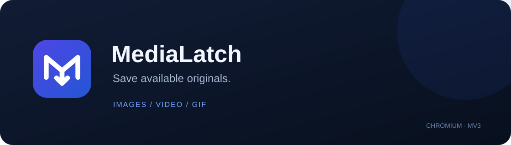

<p align="center"></p>

<p align="center"><a href="README.md">English</a> · <a href="https://github.com/xhthc/ImageSaver/releases">Скачать</a> · <a href="docs/PRIVACY.md">Приватность</a> · <a href="LICENSE">GPL-3.0</a></p>

Image Saver — расширение Chromium для сохранения доступных оригинальных изображений, видео и GIF. Нажмите ПКМ по медиа и выберите **Image Saver: Save media**. Поиск источника начинается после нажатия; подпись меню остаётся постоянной.

**Ранний релиз:** основная проверка проходит в Helium на Windows. Поддержка ограничена указанными ниже сценариями. Firefox и выпуск в Chrome Web Store запланированы.

## Возможности

- Поиск оригинала через адаптеры сайтов, ссылки, `srcset`, атрибуты медиа и однозначные CSS-фоны или перекрытия.
- Сохранение исходных изображений/GIF и доступных MP4/WebM. Объявленные ссылки, включая подписи, сохраняются точно.
- Настоящий зацикленный GIF из подтверждённых MP4-анимаций X и Reddit. Анимации длиннее 30 секунд остаются MP4; ошибки преобразования отображаются явно.
- Небольшие inline-кнопки на X, Reddit и RedGIFs; ограниченные пакеты поста на X и Reddit.
- Все уникальные объявленные оригиналы поста Pawchive из превью ленты, включая оригинальную обложку. Выбор отдельного вложения сохраняет только его.
- Подпапка внутри «Загрузок», организация по сайту/типу, результаты и копируемые отчёты об ошибках с удалёнными чувствительными данными.
- Локальная история по желанию: до 50 завершённых операций за семь дней и статистика этой истории.
- Копирование ссылок на поддерживаемые посты X, Instagram, TikTok и YouTube Shorts с выбором сервиса превью.
- Проверка релизов GitHub вручную или при открытии вкладки обновлений, не чаще раза в сутки. Автоматической установки кода расширения нет.

## Поддержка сайтов

| Источник | Текущее поведение |
|---|---|
| X / Twitter | Изображения/видео, подтверждённые MP4-анимации, inline-сохранение и пакеты поста |
| Reddit | Оригиналы, анимации, inline-сохранение; сборка отдельных конечных незашифрованных HLS-потоков Reddit с H.264/AAC в MP4 |
| RedGIFs | Выбранный ролик и варианты того же ролика; inline-сохранение и восстановление варианта со звуком, когда доступен |
| Pawchive | Оригиналы поста из превью или отдельного вложения; до 20 файлов, интервалы запусков и остановка при ограничении запросов |
| Другие сайты | Универсальный поиск и существующие правила, включая Pixiv и отдельные booru-сценарии; результат зависит от сайта |

Kemono, Sankaku и расширенная совместимость с booru требуют дальнейшей интеграции и проверки. По миниатюре нельзя подтвердить оригинал. Неоднозначный элемент или недоступный источник могут привести к отказу сохранения.

## Установка

1. Скачайте **готовый архив ImageSaver-*.zip** из [Releases](https://github.com/xhthc/ImageSaver/releases) и распакуйте. Автоматический Source code ZIP GitHub содержит весь репозиторий для разработки.
2. Откройте `chrome://extensions`, включите **Режим разработчика**, нажмите **Загрузить распакованное расширение** и выберите папку с `manifest.json`.
3. После замены сборки перезагрузите расширение **и обновите вкладки сайтов**.

Можно клонировать репозиторий и загрузить его корневую папку:

```bash
git clone https://github.com/xhthc/ImageSaver.git
```

Страницы `popup/` уже собраны; Node/npm нужны только для разработки. Распакованное расширение обновляется вручную. Обновления через магазины будут отдельным способом распространения.

## Использование и настройки

Нажмите ПКМ по изображению, видео или поддерживаемому превью и выберите **Image Saver: Save media**. На X сочетание Shift + ПКМ помогает открыть меню браузера, если сайт обрабатывает нажатие сам.

Всплывающее окно показывает недавние результаты. Полная страница содержит историю, настройки сохранения, уведомления, ссылки и релизы. По умолчанию файлы идут в `Загрузки/SavedImages/`. Организация по сайту и типу создаёт пути вроде `SavedImages/x/pic/`, `video/` и `gif/`.

Путь задаётся относительно загрузок браузера. Произвольные диски и папки авторов пока в планах. Обычными передачами управляет браузер; для подходящего `NETWORK_FAILED` предусмотрена одна попытка штатного возобновления.

## Ограничения и приватность

DRM, обход доступа, произвольные blob/MSE-плееры и универсальная загрузка HLS/DASH не поддерживаются. Отдельные звуковые дорожки объединяются только в поддерживаемом сценарии Reddit HLS. Отсутствующие файлы и ограничения сайтов нельзя гарантированно устранить.

GIF: вход до 50 МиБ, длительность до 30 секунд, 150 кадров, 640 px, выход до 15 МиБ и время до 45 секунд. Буферизация изображений Pixiv ограничена 50 МиБ. Это пределы отдельных обработчиков, а не всех прямых загрузок.

Телеметрии и сервера расширения нет. История изначально выключена, отчёты копируются по запросу. Поиск и сохранение обращаются к сайтам/CDN, проверка релизов — к GitHub. Подробнее — в [политике приватности](docs/PRIVACY.md).

## Планы

Эти функции **ещё не входят в релиз**:

- Оригиналы Kemono, расширение Sankaku, booru и универсального поиска.
- Миниатюрные универсальные inline-кнопки и отключаемое выделение нескольких постов/медиа.
- Менеджер с очередью, прогрессом, паузой, возобновлением и контролем частоты; получение полного файла перед передачей на ПК, где доступно.
- Пакеты постов/страницы; сначала ZIP, затем исследование 7z.
- Выбор папки и организация по автору, начиная с X.
- Firefox, проверки других браузеров и выпуск в магазинах.

## Разработка

Рекомендуется Node.js 26 либо совместимый с UI lockfile runtime.

```bash
npm ci --prefix ui
npm run build --prefix ui
node tools/verify.mjs --ui
node tools/package.mjs HEAD
```

Правьте `ui/` и пересобирайте `popup/`. Проверки включают регрессии, типы, рендеринг и совпадение исходников UI со сборкой. Звук, воспроизведение и скачанные байты проверяются отдельно в браузере. Упаковка берёт принятый Git-коммит и создаёт архив с SHA, версией и хешем в `local-notes/releases/`.

[Архитектура](docs/ARCHITECTURE.md) · [Подготовка релиза](docs/RELEASE.md) · [Изменения](CHANGELOG.md)

[Тесты](test_suite.js): основной набор можно запустить отдельно командой `node test_suite.js`.

## Лицензия

Собственный код — **GPL-3.0-only**. Сторонний код и графические символы сохраняют свои лицензии: [общие уведомления](THIRD_PARTY_NOTICES.txt), [UI](popup/THIRD_PARTY_NOTICES.txt) и [MP4Box](lib/vendor/mp4box/2.4.1/LICENSE).
