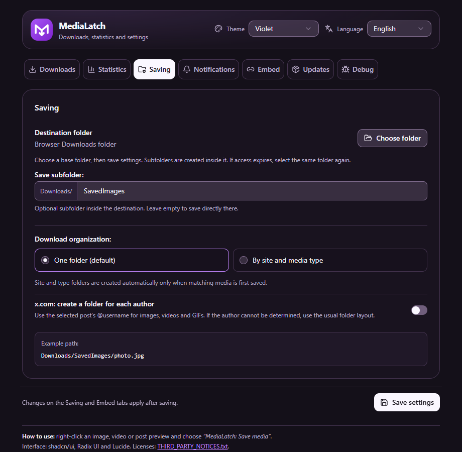
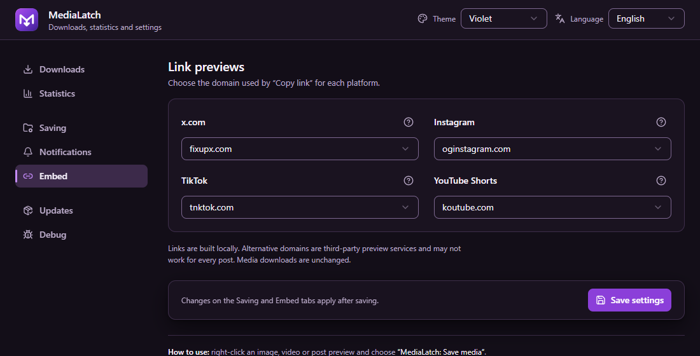

<div align="center">
  
  <h1>MediaLatch</h1>
  <p><i>«Сохраняйте доступные оригиналы прямо из браузера — изображения, видео и GIF, разложенные по вашим папкам.»</i></p>
  <p>
    <a href="https://github.com/xhthc/MediaLatch/releases/tag/v2.0.0.29"></a>
    
    
    
    <a href="LICENSE"></a>
  </p>
  <p>
    <a href="https://github.com/xhthc/MediaLatch/releases/tag/v2.0.0.29"></a>
    
    
  </p>
  <p><a href="README.md">English</a> · <a href="#быстрый-старт">Быстрый старт</a> · <a href="#установка">Установка</a> · <a href="#roadmap">Roadmap</a> · <a href="docs/PRIVACY.md">Приватность</a></p>
</div>

MediaLatch (ранее Image Saver) — расширение Chromium для сохранения доступных оригинальных изображений, видео и GIF. Нажмите ПКМ по медиа и выберите **Save media**, следите за параллельными загрузками и выбирайте, куда сохранять файлы — в том числе **в отдельную папку для каждого автора x.com**.

> **Текущее превью: [v2.0.0.29](https://github.com/xhthc/MediaLatch/releases/tag/v2.0.0.29).** Фиолетовый интерфейс, выбор папки, альбомы Pixiv и уведомления на исходной странице. Настройки на русском и английском, статистика и плавные переходы с учётом уменьшения движения.

В ветке разработки `main` также есть объединение уведомлений при массовом сохранении, более стабильный значок загрузки, кнопки расположения файлов и дальнейший рефакторинг worker. Эти изменения пока не включены в скачиваемое превью. Реальные окна Windows, поведение popup и расширенная ручная проверка пока не подтверждены.

Основная проверка проходит в Helium на Windows. Поддержка ограничена указанными ниже сценариями; разметка и правила доступа сайтов могут меняться. Firefox и выпуск в Chrome Web Store запланированы.

---

## Интерфейс

<table>
  <tr>
    <td width="50%"><br><strong>Куда сохранять файлы</strong><br>Папка, необязательная подпапка, папки авторов и пример пути.</td>
    <td width="50%"><br><strong>Как делиться ссылками</strong><br>Один список для каждой платформы; подробности раскрываются отдельно.</td>
  </tr>
</table>

Текущий интерфейс с демонстрационными настройками; скриншоты на английском. Фиолетовая тема по умолчанию, русский/английский языки и короткие анимации с учётом уменьшения движения.

---

## Быстрый старт

1. Установите готовый архив по инструкции ниже.
2. Нажмите ПКМ по изображению, видео или поддерживаемому превью и выберите **MediaLatch: Save media**. На X попробуйте **Shift + ПКМ**, если сайт перехватывает меню.
3. Следите за загрузками в popup. **Открыть менеджер загрузок** ведёт к подробностям, отмене и повторному сохранению подготовленного файла. Уведомления MediaLatch появляются на исходной странице.
4. Откройте **Сохранение**, выберите папку и организацию, затем нажмите **Сохранить настройки**. По умолчанию используется `Загрузки/SavedImages/`.

Автоматическое знакомство при первом запуске пока запланировано; эта инструкция доступна уже сейчас.

---

## Установка

1. Скачайте **готовый архив расширения** из [Releases](https://github.com/xhthc/MediaLatch/releases) и распакуйте. Выберите `MediaLatch-2.0.0.29-*.zip` из текущего превью; в имени архива указан исходный коммит. Автоматический Source code ZIP GitHub содержит весь репозиторий для разработки.
2. Откройте `chrome://extensions`, включите **Режим разработчика**, нажмите **Загрузить распакованное расширение** и выберите папку с `manifest.json`.
3. После замены сборки перезагрузите расширение **и обновите вкладки сайтов**.

Можно клонировать репозиторий и загрузить его корневую папку:

```bash
git clone https://github.com/xhthc/MediaLatch.git
```

Для обновления распакованного расширения замените файлы в его существующей папке, нажмите **Перезагрузить** на странице расширений браузера и обновите вкладки сайтов. Сохраните прежний путь папки, чтобы идентификатор и настройки расширения остались теми же.

Страницы `popup/` уже собраны; Node/npm нужны только для разработки. Распакованное расширение обновляется вручную. Обновления через магазины будут отдельным способом распространения.

---

## Возможности

Готовое превью включает описанные функции. В Helium проверены обычные загрузки, темы, статистика, выбранная папка и альбомы Pixiv. Проверки аварийного завершения/перезапуска, нагрузки на квоту и более широкого набора кодеков и аудио ещё ожидаются.

### Сохранение выбранного медиа

- Поиск оригинала через адаптеры сайтов, ссылки, `srcset`, атрибуты медиа и однозначные CSS-фоны или перекрытия.
- Сохранение исходных изображений/GIF и доступных MP4/WebM. Объявленные ссылки, включая подписи, сохраняются точно.
- Настоящий зацикленный GIF из подтверждённых MP4-анимаций X и Reddit. Анимации длиннее 30 секунд или превышающие лимиты размера конвертации сохраняются исходным MP4; остальные ошибки преобразования отображаются явно.
- Небольшие inline-кнопки на X, Reddit и RedGIFs; ограниченные пакеты поста на X и Reddit.
- Все уникальные объявленные оригиналы поста Pawchive из превью ленты, включая оригинальную обложку. Выбор отдельного вложения сохраняет только его.

### Управление файлами

- Выбор базовой папки с правом записи, необязательной подпапки и организации по сайту/типу. Для X доступны папки по username автора выбранного поста. Результаты и отчёты об ошибках без чувствительных данных остаются в менеджере.
- Менеджер загрузок с полученным/полным размером, скоростью и примерным оставшимся временем, когда их можно измерить. Полный файл сначала сохраняется во временное локальное хранилище; повтор выдачи после ошибки не требует нового скачивания источника.

### Настройки и диагностика

- Собственные уведомления MediaLatch на исходной странице: закрытие, переход в менеджер, общая тема и отказ от уведомлений Windows. Закрытая вкладка или переход на другой сайт мешают показу; результаты и значок ошибки остаются в расширении. Уведомления об успехе отключаются отдельно.
- Фиолетовая тема по умолчанию, с выбором синей, тёмной и светлой. Тема общая для popup и настроек; прежний выбор сохраняется. Короткие анимации учитывают системное уменьшение движения.
- Добровольная локальная статистика без лимита числа записей и срока, с выключателем учёта и очисткой. Сохранившаяся старая история переносится один раз; удалённые записи восстановить нельзя.
- Отключаемый локальный журнал Debug с фильтрами, копированием, экспортом и очисткой: до 2 000 событий, 1 МиБ и 24 часов. Полные ссылки, токены, текст страниц и локальные пути исключены.
- Копирование ссылок на поддерживаемые посты X, Instagram, TikTok и YouTube Shorts с выбором сервиса превью.
- Проверка релизов GitHub вручную или при открытии вкладки обновлений, не чаще раза в сутки. Автоматической установки кода расширения нет.

---

## Поддержка сайтов

| Источник | Текущее поведение |
|---|---|
| X / Twitter | Изображения/видео, подтверждённые MP4-анимации, inline-сохранение и пакеты поста |
| Reddit | Оригиналы, анимации, inline-сохранение; сборка отдельных конечных незашифрованных HLS-потоков Reddit с H.264/AAC в MP4 |
| RedGIFs | Выбранный ролик и варианты того же ролика; inline-сохранение и восстановление варианта со звуком, когда доступен |
| Pawchive | Оригиналы поста из превью или отдельного вложения; общий предел 100 файлов, интервалы запусков и остановка при ограничении запросов |
| Sankaku | Превью/уменьшенное медиа → объявленный оригинал того же поста через ПКМ в ленте/открытом посте; пользователь проверил картинки/видео в Helium, живая проверка GIF отложена |
| Pixiv | Превью в ленте сохраняет объявленные оригиналы поста (до 100); выбранная картинка внутри открытого поста сохраняется отдельно |
| Другие сайты | Универсальный поиск и существующие правила, включая отдельные booru-сценарии; результат зависит от сайта |

Kemono отложен, пока сайт недоступен. Расширенная совместимость с booru требует отдельной интеграции и проверки. По миниатюре нельзя подтвердить оригинал. Неоднозначный элемент или недоступный источник могут привести к отказу сохранения. Ограничения поиска и подписки Sankaku соблюдаются; это превью их не обходит.

Для существующих пакетных сохранений X, Reddit, Pixiv и Pawchive действует общий предел 100 вложений выбранного поста. Проверки полного списка и владельца каждого файла сохраняются; расширение не превращает всю ленту в один пакет. Число одновременно обрабатываемых файлов ограничено, а HTTP 429 прекращает дальнейший запуск там, где это поддержано.

---

## Использование и настройки

Нажмите ПКМ по изображению, видео или поддерживаемому превью и выберите **MediaLatch: Save media**. На X сочетание Shift + ПКМ помогает открыть меню браузера, если сайт обрабатывает нажатие сам.

Всплывающее окно показывает загрузки и этапы поиска/обработки источника. Полная страница содержит статистику, загрузки, настройки сохранения, уведомления, ссылки и релизы. По умолчанию файлы идут в `Загрузки/SavedImages/`. Организация по сайту и типу создаёт пути вроде `SavedImages/x/pic/`, `video/` и `gif/`.

Выберите **Язык** вверху полной страницы, чтобы переключиться между английским и русским. Сохранённый выбор сразу применяется к страницам расширения, уведомлениям и встроенным кнопкам. Без сохранённого выбора браузер на русском показывает русский, любой другой — английский. Пункт меню остаётся **MediaLatch: Save media** на обоих языках. Переименование сохраняет существующие настройки и папки.

Чтобы найти это превью во вкладке **Обновления**, выберите **Канал обновлений → Обычные и beta-релизы** или скачайте архив прямо из Releases. Распакованное расширение обновляется вручную.

Для диагностики включите запись в **Debug**, повторите проблему и скопируйте или экспортируйте события с нужными фильтрами. Запись начинается после включения; выключение сохраняет журнал до очистки или истечения срока хранения. Отчёты остаются локальными, пока вы сами ими не поделитесь.

В разделе **Сохранение** выберите базовую папку с правом записи и нажмите **Сохранить настройки**. Подпапки создаются внутри неё. Без выбранной папки используется папка загрузок браузера. Опция **X: отдельная папка для каждого автора** берёт username автора выбранного поста в нижнем регистре: `SavedImages/username/file.jpg`, либо `SavedImages/x/username/pic/file.jpg` при разделении по сайтам и типам. Для цитат используется их собственный автор; если автор не подтверждён, остаётся обычная структура. Другие сайты сохраняют прежнюю структуру.

Выбор папки требует поддержки File System Access API в браузере. Такие файлы записываются напрямую и отображаются в менеджере MediaLatch, а не в истории загрузок Chrome. Существующие файлы сохраняются: совпадающее имя получает номер. После перезапуска браузера может понадобиться снова выбрать ту же папку и сохранить настройки для возврата доступа; готовые файлы после этого можно сохранить повторно. Смена папки применяется к новым элементам очереди. При отмене записи может остаться пустой файл. Расширение получает файл в закрытое дисковое хранилище и проверяет его перед выдачей. Очередь получает до трёх файлов одновременно, максимум два с одного источника. Приостановка останавливает новые передачи, но не поиск источника или уже начатую передачу. Для неизвестного размера проценты и оставшееся время не выдумываются. Обработка сохраняет прежние ограничения ресурсов GIF/HLS.

После ошибки выдачи готовые байты остаются для явного повтора; удаление записи очищает временный файл, а не скачанный вами. Прерванное получение при повторе начинается заново по точной ссылке; продолжение частичной передачи не обещается. После перезапуска расширение сверяет свои сохранения браузера и не запускает дубликаты. Устаревший выбор или источник могут потребовать нового клика на сайте. Подробности и отчёты остаются на полной странице загрузок.

---

## Ограничения и приватность

DRM, обход доступа, произвольные blob/MSE-плееры и универсальная загрузка HLS/DASH не поддерживаются. Отдельные звуковые дорожки объединяются только в поддерживаемом сценарии Reddit HLS. Отсутствующие файлы и ограничения сайтов нельзя гарантированно устранить.

GIF: вход до 50 МиБ, длительность до 30 секунд, 150 кадров, 640 px, выход до 15 МиБ и время до 45 секунд. Буферизация изображений Pixiv ограничена 50 МиБ. Это пределы отдельных обработчиков, а не всех прямых загрузок.

Телеметрии и сервера расширения нет. Учёт статистики и запись Debug изначально выключены, отчёты копируются или экспортируются по запросу. Поиск и сохранение обращаются к сайтам/CDN, проверка релизов — к GitHub. Подробнее — в [политике приватности](docs/PRIVACY.md).

---

## Roadmap

Статусы отделяют реализованные функции от будущих задач. Они задают направление, а не сроки или обещание поддержки любой разметки. Сначала надёжность; для каждой функции нужны отдельная реализация и проверка в браузере.

| Направление | Планируемый результат | Статус |
|---|---|---|
| Booru и универсальный поиск | Проверенные общие правила оригиналов/владения медиа для изученных движков; улучшение выбранного медиа и результатов Яндекс/Google Картинок | Следующий этап совместимости |
| Кнопки и выделение | Маленькие универсальные inline-кнопки и отключаемое выделение нескольких постов/медиа | Запланировано |
| Менеджер загрузок | Дополнить работающую очередь файлов последовательным поиском источников постов, итогами пакетов и проверенным продолжением передачи | Очередь файлов включена в превью; остальное запланировано |
| Подготовка полного файла | Получение/проверка на диске до выдачи и локальный повтор; расширить проверки перезапуска, квоты и медиа в браузере | Включено в превью; обычные проверки в Helium пройдены, стресс-проверки ожидаются |
| Пакеты и архивы | Выбранные посты/страница, сначала ZIP; 7z только при оправданной реализации с ограниченными ресурсами | Запланировано |
| Папки и имена | Выбор базовой папки с правом записи и опциональные папки авторов X | Пользователь подтвердил внешнюю папку и сохранения по авторам X в Helium; восстановление доступа после перезапуска и другие разметки пока не проверены |
| Kemono | Объявленные оригиналы своего поста и отдельные сценарии ленты | Отложено до восстановления сайта |
| Публикация по желанию | Отдельные редакторы VK/Telegram, предпросмотр и явная отправка, затем расписание и восстановление без дублей | Позже; авторизация, токены и надёжный планировщик требуют отдельного проекта |
| Браузеры и распространение | Другие Chromium, порт Firefox, Chrome Web Store и обновления через магазин | Запланировано; сначала безопасность/приватность |
| Настройки и документация | Компактные группы настроек, быстрый старт со скриншотами и README EN/RU | Включено в превью; визуальная проверка пользователем ожидается |
| Первое включение | Короткое знакомство: выбрать папку, освоить ПКМ/встроенные кнопки, открыть менеджер и сделать первую загрузку; пропуск или повторное открытие инструкции | Запланировано; отдельная задача |

Roadmap Telegram/VK касается **публикации**.

---

## Безопасность перед выпуском в магазине

До подачи в магазин: проверки кода/CSP в архиве, отправителя/действия/фрейма сообщений, URL/перенаправлений и локальной сети, минимальных разрешений, зависимостей/целостности релиза, повреждённых медиа и исчерпания ресурсов. Широкий доступ к HTTP/HTTPS требует отдельного внимания. Это **план готовности, а не завершённый аудит или одобрение магазином**. Исполняемый код поставляется локально; проверка релизов читает метаданные и не устанавливает код.

Подробнее: [безопасность](docs/SECURITY.md), [приватность](docs/PRIVACY.md) и [подготовка релиза](docs/RELEASE.md).

---

## Разработка

Структура проекта: `content/` — скрипты сайтов; `lib/` — общие модули и логика worker; `ui/` — исходники интерфейса; `popup/` — готовая сборка; `tests/` — проверки; `tools/` — сборка и упаковка. Основной вход worker остаётся `background.js`. Новые функции можно добавлять в соответствующий модуль.


Рекомендуется Node.js 26 либо совместимый с UI lockfile runtime.

```bash
npm ci --prefix ui
npm run build --prefix ui
node tools/verify.mjs --ui
node tools/package.mjs HEAD
```

Правьте `ui/` и пересобирайте `popup/`. Проверки включают регрессии, типы, рендеринг и совпадение исходников UI со сборкой. Звук, воспроизведение и скачанные байты проверяются отдельно в браузере. Упаковка берёт принятый Git-коммит и создаёт архив с SHA, версией и хешем в `local-notes/releases/`.

[Архитектура](docs/ARCHITECTURE.md) · [Подготовка релиза](docs/RELEASE.md) · [Изменения](CHANGELOG.md)

[Тесты](tests/test_suite.js): основной набор можно запустить отдельно командой `node tests/test_suite.js`.

---

## Лицензия

Собственный код — **GPL-3.0-only**. Сторонний код и графические символы сохраняют свои лицензии: [общие уведомления](THIRD_PARTY_NOTICES.txt), [UI](popup/THIRD_PARTY_NOTICES.txt) и [MP4Box](lib/vendor/mp4box/2.4.1/LICENSE).
