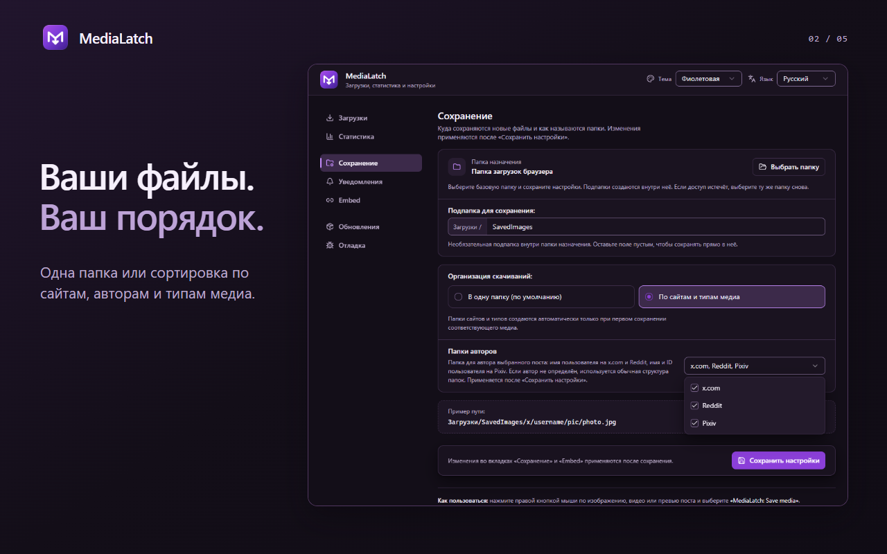
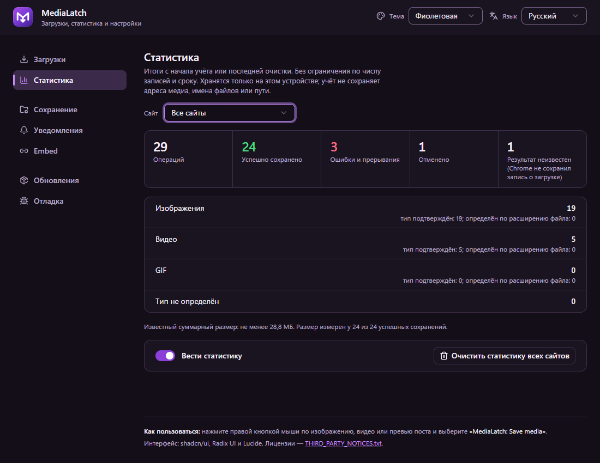
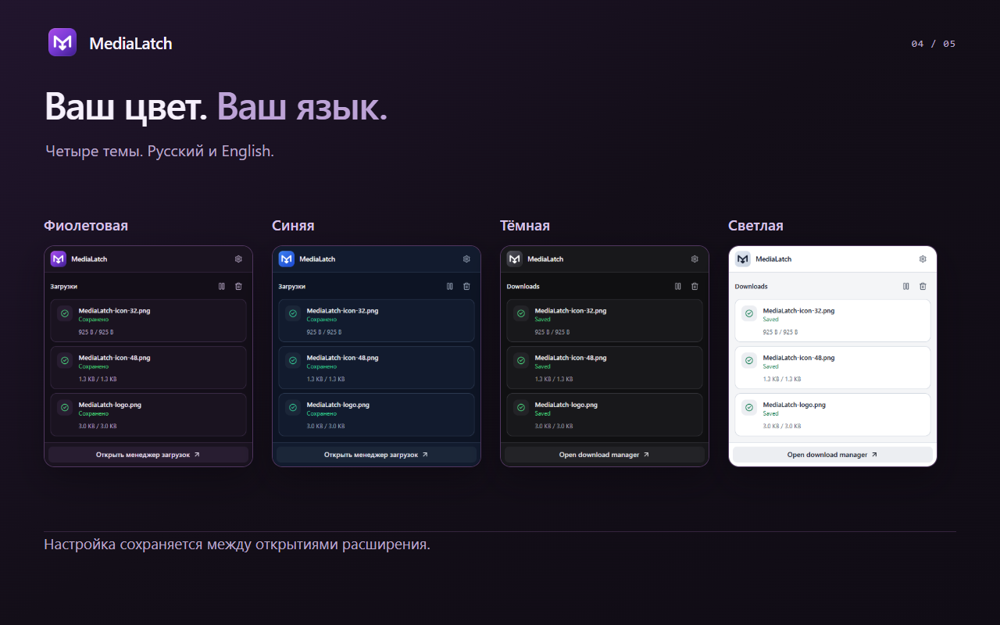

<div align="center">
  
  <h1>MediaLatch</h1>
  <p><i>«Сохраняйте доступные оригиналы прямо из браузера — изображения, видео и GIF, разложенные по вашим папкам.»</i></p>
  <p>
    <a href="https://github.com/xhthc/MediaLatch/releases/tag/v2.5.8"></a>
    
    
    
    <a href="LICENSE"></a>
  </p>
  <p>
    <a href="https://github.com/xhthc/MediaLatch/releases/tag/v2.5.8"></a>
    
    
  </p>
  <p><a href="README.md">English</a> · <a href="#быстрый-старт">Быстрый старт</a> · <a href="#установка">Установка</a> · <a href="#roadmap">Roadmap</a> · <a href="docs/PRIVACY.md">Приватность</a></p>
</div>

MediaLatch (ранее Image Saver) сохраняет доступные оригиналы изображений, видео и GIF прямо из браузера. Выберите нужное медиа, следите за сохранением в менеджере загрузок и находите файл в выбранной папке. Дополнительная программа не нужна.

> **Текущее превью: [v2.5.8](https://github.com/xhthc/MediaLatch/releases/tag/v2.5.8).** Inline-скачивание ограничено проверенными сервисами, иконки копирования обновлены, добавлена экспериментальная загрузка видео TikTok/Instagram через контекстное меню браузера. Удаление лишних кнопок подтверждено пользователем. Полная проверка живой ленты и воспроизведения со звуком ещё не завершена. [Что изменилось](CHANGELOG.md).


| Задача | Что предлагает MediaLatch |
|---|---|
| Сохранить выбранное медиа | Контекстное меню и inline-кнопки на поддерживаемых сайтах |
| Разложить файлы по папкам | Одна папка, разделение по сайту/типу или папки аккаунтов публикации (X, Reddit, Pixiv, VK, RedGIFs, Instagram, TikTok) |
| Следить за каждой загрузкой | Прогресс файлов, итоги поста, отмена, повторы и понятные ошибки |
| Настроить под себя | Фиолетовая, синяя, тёмная и светлая темы; русский и английский |
| Хранить записи на устройстве | Статистика и Debug по желанию; без аналитики и автоматической отправки отчётов |

Основная проверка проходит в Helium на Windows. Поддержка ограничена указанными ниже сценариями; разметка и правила доступа сайтов могут меняться. Firefox запланирован. По сообщению пользователя, версия Chrome Web Store 2.5.2 прошла проверку и была опубликована, затем случайно скрыта; этот GitHub-релиз не восстанавливает публикацию магазина.

---

## Интерфейс



<details>
<summary>Другие экраны интерфейса</summary>

<table>
  <tr>
    <td width="50%"><br><strong>Начало в три шага</strong><br>После новой установки один раз открывается короткий экран приветствия; «Продолжить» ведёт в настройки сохранения.</td>
    <td width="50%"><br><strong>Ход каждой загрузки</strong><br>Группы сайтов с отдельными списками одиночных файлов и постов, прогресс и отмена остатка пакета.</td>
  </tr>
  <tr>
    <td width="50%"><br><strong>Куда сохранять файлы</strong><br>Папка, необязательная подпапка, папки авторов и пример пути.</td>
    <td width="50%"><br><strong>Как делиться ссылками</strong><br>Компактная сетка из четырёх списков со справкой возле платформы.</td>
  </tr>
</table>



</details>

Менеджер загрузок и настройки превью ссылок показаны на страницах v2.5.4 с нейтральными тестовыми данными в отдельном профиле Chromium: это демонстрация интерфейса, а не сохранение с настоящего сайта. Статистика сохраняет снимки v2.5.3; приветствие, настройки сохранения и иллюстрированные карточки — v2.5.1. Проверки байтов файлов и ручные проверки пользователя описаны отдельно ниже.

---

## Быстрый старт

1. Установите готовый архив по инструкции ниже.
2. Нажмите ПКМ по изображению, видео или поддерживаемому превью и выберите **MediaLatch: Save media**. На X попробуйте **Shift + ПКМ**, если сайт перехватывает меню.
3. Следите за загрузками в popup. **Открыть менеджер загрузок** ведёт к подробностям, отмене и повторному сохранению подготовленного файла. Уведомления MediaLatch появляются на исходной странице.
4. Откройте **Сохранение**, выберите папку и организацию, затем нажмите **Сохранить настройки**. По умолчанию используется `Загрузки/SavedImages/`.

При новой установке один раз открывается короткое приветствие. **Продолжить** ведёт в **Сохранение**. Папки и сервисы превью применяются после **Сохранить настройки**; тема, язык и переключатели уведомлений — сразу.

<details>
<summary>Приветствие, сохранение настроек и состояния ошибок</summary>

После новой установки открывается отдельный экран приветствия из трёх коротких шагов. **Продолжить** запоминает его и открывает **Сохранение**; экран показывается только при этой первой установке, никогда после обновлений или перезапуска браузера, и кнопки обучения потом нет. «Сохранение» и «Embed» показывают **несохранённые изменения**, когда форма отличается от сохранённого (в том числе сразу после сохранения), ход сохранения, успех или постоянную ошибку; при ошибке чтения настроек есть кнопка **Повторить**. Оба менеджера загрузок объясняют ошибки понятным языком, одинаково на карточке и в подробностях, и показывают технический код отдельной строкой.

</details>

---

## Установка

1. Скачайте **готовый архив расширения** из [Releases](https://github.com/xhthc/MediaLatch/releases) и распакуйте. Выберите `MediaLatch-2.5.8-*.zip` из текущего превью; в имени архива указан исходный коммит. Автоматический Source code ZIP GitHub содержит весь репозиторий для разработки.
2. Откройте `chrome://extensions`, включите **Режим разработчика**, нажмите **Загрузить распакованное расширение** и выберите папку с `manifest.json`.
3. После замены сборки перезагрузите расширение **и обновите вкладки сайтов**.


Можно клонировать репозиторий и загрузить его корневую папку:

```bash
git clone https://github.com/xhthc/MediaLatch.git
```

Для обновления распакованного расширения замените файлы в его существующей папке, нажмите **Перезагрузить** на странице расширений браузера и обновите вкладки сайтов. Сохраните прежний путь папки, чтобы идентификатор и настройки расширения остались теми же.

Страницы `popup/` уже собраны; Node/npm нужны только для разработки. Распакованное расширение обновляется вручную. Обновления через магазины будут отдельным способом распространения.

---

## Возможности

Текущее превью включает сценарии ниже. Доступность зависит от страницы, формата медиа и вашего доступа к источнику; подробнее — в [поддержке сайтов](#поддержка-сайтов) и [ограничениях](#ограничения-и-приватность).

### Сохранение выбранного медиа

- Поиск оригинала через адаптеры сайтов, ссылки, `srcset`, атрибуты медиа и однозначные CSS-фоны или перекрытия.
- Сохранение исходных изображений/GIF и доступных MP4/WebM. Объявленные ссылки, включая подписи, сохраняются точно.
- Настоящий зацикленный GIF из подтверждённых MP4-анимаций X и Reddit. Анимации длиннее 30 секунд или превышающие лимиты размера конвертации сохраняются исходным MP4; остальные ошибки преобразования отображаются явно.
- Общие inline-кнопки X, Reddit, Pixiv, RedGIFs и VK. На поддерживаемых карточках и открытых работах Pixiv доступны сохранение выбранного оригинала и всех страниц подтверждённой многостраничной работы. У TikTok и Reels Instagram есть отдельные кнопки, описанные ниже. На остальных сайтах используйте контекстное меню браузера.
- Выбранные видео TikTok и Reels/видеопосты Instagram через меню браузера **MediaLatch: Save media** (правый клик по воспроизводимому видео). Сохраняется прогрессивный MP4, который объявляет сам выбранный элемент, вместе со звуком; соседнее видео, постер или угаданный адрес не используются. В TikTok отдельные кнопки копирования ссылки и скачивания находятся прямо под нативной кнопкой **⋯** на видео (мышь или клавиатура). Они перемещаются вместе с роликом и не добавляются внутрь меню или панели с аватаром; обычный правый клик оставляет собственное меню плеера TikTok, а Shift+правый клик по плееру открывает меню браузера с **MediaLatch: Save media**. Если плеер закрыт диалогом или меню, кнопка отказывает, а не сохраняет другое видео. На страницах Reels Instagram (лента Reels и открытый Reel) кнопки копирования ссылки и скачивания стоят друг под другом в правом верхнем углу видео выбранного Reel: видны, пока указатель над этим видео, скрываются при уходе, всегда доступны с клавиатуры (на устройствах без наведения видны всегда). Они заменяют прежнюю кнопку копирования над «Нравится»; у обычных публикаций кнопка копирования прежняя. Скачивание сохраняет Reel, который сейчас в кадре (та же проверка, что у копирования); Reel под диалогом, соседний Reel или переиспользованный плеер отклоняются с видимой ошибкой. Элементы Instagram, которые страница отдаёт только отдельными потоками видео и звука (например, часть элементов, догруженных позже в ленте с входом), завершаются ошибкой «неподдерживаемый источник», а не беззвучным или угаданным файлом.
- Экспериментальное сохранение фото VK на vk.ru/vk.com: выбранное фото и все вложения подтверждённой полной карусели/коллажа. Кнопки сохраняют постоянный отступ от верхнего левого угла самого медиа и прокручиваются вместе с ним.
- Все уникальные объявленные оригиналы поста Pawchive из превью ленты, включая оригинальную обложку. Выбор отдельного вложения сохраняет только его.

### Управление файлами

- Подтверждённый аккаунт публикации виден в уведомлении, popup и Downloads настроек, включая пакеты и повторы. Аккаунт указывается, только когда медиа явно принадлежит самому посту: комментарии, ответы, цитаты, аватар в шапке и медиа в ссылке на профиль не получают аккаунт поста; у неизвестных аккаунтов и старых записей подписи нет.
- «Показать в папке» (popup и Downloads настроек) открывает в папке именно сохранённый файл завершённой браузерной загрузки, включая переименованный «photo (1).jpg». У файлов, записанных в выбранную папку, нет записи загрузки браузера, поэтому значка у них нет.
- Выбор базовой папки с правом записи и необязательной подпапки: все файлы в одну папку либо разделение по сайту и типу. Одно меню «Папки авторов» включает любое сочетание x.com, Reddit, Pixiv, VK, RedGIFs, Instagram и TikTok. Папка называет аккаунт публикации выбранного поста (для Pixiv — имя и ID), а не автора изображения; при неизвестном или неоднозначном аккаунте используется обычная структура. Результаты и отчёты об ошибках без чувствительных данных остаются в менеджере.
- Компактный popup с прокруткой колёсиком/клавиатурой, полупрозрачным собственным скроллбаром и общей очисткой завершённых записей. Удаление отдельных записей и подробности остаются в полном менеджере.
- Менеджер загрузок с полученным/полным размером, скоростью и примерным оставшимся временем, когда их можно измерить. Полный файл сначала сохраняется во временное локальное хранилище; повтор выдачи после ошибки не требует нового скачивания источника.

В обоих менеджерах одиночные и пакетные загрузки объединены по сайтам. Новое сохранение поднимает существующую группу сайта наверх. Внутри отдельно расположены «Отдельные файлы» и компактные карточки постов; завершённые подгруппы изначально свёрнуты и раскрываются кликом или с клавиатуры. Итоги различают сохранённые, ошибочные, отменённые, пропущенные и оставшиеся файлы. «Отменить оставшиеся» останавливает незавершённую работу только этого поста, сохраняя уже скачанные файлы и не затрагивая другие загрузки. Повтор обновляет ту же запись; частичные импорты Pawchive сохраняют пояснение. Удаление завершённой записи находится в раскрываемых подробностях полного менеджера.

### Настройки и диагностика



- Одна обновляемая карточка на странице для пакета X/Reddit, многостраничного Pixiv или поста Pawchive с несколькими оригиналами; счётчики совпадают с менеджером. Одиночные сохранения сохраняют обычные уведомления; неполный импорт Pawchive — отдельное сообщение о причине. Закрытая вкладка или переход на другой сайт мешают показу; результаты и значок ошибки остаются в расширении. Уведомления об успехе отключаются отдельно.
- Фиолетовая тема по умолчанию, с выбором синей, тёмной и светлой; иконки MediaLatch в интерфейсе и панели браузера соответствуют теме. Выбор общий для popup, настроек и уведомлений; прежние предпочтения сохраняются. Короткие анимации учитывают системное уменьшение движения.
- Локальная статистика по желанию: «Все сайты» и только сервисы с учтёнными операциями; booru-сайты объединены в один пункт. Итоги и доступная старая история сохраняются без угадывания сайта старых записей. Учёт и очистка общие для всех сайтов; очистка не удаляет скачанные файлы.
- Отключаемый локальный журнал Debug с фильтрами, копированием, экспортом и очисткой: до 2 000 событий, 1 МиБ и 24 часов. Полные ссылки, токены, текст страниц и локальные пути исключены.
- Копирование ссылок на поддерживаемые посты X, Instagram, TikTok и YouTube Shorts с выбором сервиса превью. Сервис выбирается для каждой платформы; само копирование не отправляет ему запрос.
- Проверка релизов GitHub вручную или при открытии вкладки обновлений, не чаще раза в сутки. Автоматической установки кода расширения нет.

---

## Поддержка сайтов

| Источник | Текущее поведение |
|---|---|
| X / Twitter | Изображения/видео, подтверждённые MP4-анимации, inline-сохранение и пакеты поста |
| Reddit | Оригиналы, анимации, inline-сохранение; сборка отдельных конечных незашифрованных HLS-потоков Reddit с H.264/AAC в MP4 |
| RedGIFs | Выбранный ролик и варианты того же ролика; inline-сохранение и восстановление варианта со звуком, когда доступен |
| Pawchive | Оригиналы поста из превью или отдельного вложения; общий предел 100 файлов, интервалы запусков и остановка при ограничении запросов |
| Sankaku | Превью/уменьшенное медиа → объявленный оригинал того же поста через ПКМ в ленте/открытом посте; пользователь проверил картинки/видео в Helium, живая проверка GIF отложена |
| Booru-доски | Danbooru, Gelbooru/rule34.xxx/safebooru.org и семейство Moebooru: yande.re, Konachan, Sakugabooru. Выбранное превью/медиа поста разрешается в объявленный оригинал того же поста и файла; ограничения доступа и страницы проверки могут мешать сохранению |
| Zerochan | Выбранная миниатюра или медиа открытого поста разрешается в объявленный оригинал того же поста; недоступный оригинал приводит к отказу |
| Pixiv | Inline-кнопки «Сохранить это» / «Сохранить всё» на поддерживаемых превью и открытой работе; объявленные оригиналы, до 100 файлов; прежнее поведение контекстного меню сохранено |
| VK (экспериментально) | Выбранные загруженные фото и подтверждённые полные карусели/коллажи до 100 файлов; проверено пользователем в Helium. Объявленные URL сохраняются точно. Полная поддержка видео/клипов запланирована, качество оригиналов фото не подтверждено. Существующая обработка прямых видео в смешанных постах ограничена и экспериментальна. |
| Другие сайты | Универсальный поиск и существующие правила, включая отдельные booru-сценарии; результат зависит от сайта |

Kemono отложен, пока сайт недоступен. Оригинал на booru берётся со страницы или из метаданных самого поста и должен совпадать по файлу (хешу) и посту; уменьшенная копия, JPEG-версия или миниатюра никогда не сохраняются как оригинал. Другие booru-сайты не обещаются. По миниатюре нельзя подтвердить оригинал. Неоднозначный элемент или недоступный источник могут привести к отказу сохранения. Ограничения поиска и подписки Sankaku соблюдаются; это превью их не обходит.

Пакеты постов X, Reddit, Pixiv и Pawchive ограничены 100 подтверждёнными элементами. После допуска выбранные медиа, состав пакета и автор остаются фиксированными при скролле или переиспользовании узлов ленты; переход на другую страницу, смена документа и недоступный плеер/фрейм могут привести к безопасному отказу. Пакет поста не скачивает всю ленту. Подготовка источников ограничена; HTTP 429 останавливает дальнейший допуск там, где это поддерживается.

---

## Использование и настройки

<details>
<summary>Примеры папок, восстановление и диагностика</summary>

Нажмите ПКМ по изображению, видео или поддерживаемому превью и выберите **MediaLatch: Save media**. На X сочетание Shift + ПКМ помогает открыть меню браузера, если сайт обрабатывает нажатие сам.

Всплывающее окно показывает загрузки и этапы поиска/обработки источника. Полная страница содержит статистику, загрузки, настройки сохранения, уведомления, ссылки и релизы. По умолчанию файлы идут в `Загрузки/SavedImages/`. Организация по сайту и типу создаёт пути вроде `SavedImages/x/pic/`, `video/` и `gif/`.

Выберите **Язык** вверху полной страницы, чтобы переключиться между английским и русским. Сохранённый выбор сразу применяется к страницам расширения, уведомлениям и встроенным кнопкам. Без сохранённого выбора браузер на русском показывает русский, любой другой — английский. Пункт меню остаётся **MediaLatch: Save media** на обоих языках. Переименование сохраняет существующие настройки и папки.

Чтобы найти это превью во вкладке **Обновления**, выберите **Канал обновлений → Обычные и beta-релизы** или скачайте архив прямо из Releases. Распакованное расширение обновляется вручную.

Для диагностики включите запись в **Debug**, повторите проблему и скопируйте или экспортируйте события с нужными фильтрами. Запись начинается после включения; выключение сохраняет журнал до очистки или истечения срока хранения. Отчёты остаются локальными, пока вы сами ими не поделитесь.

В разделе **Сохранение** выберите базовую папку, необязательную подпапку и режим **Одна папка** либо **По сайту и типу медиа**, затем нажмите **Сохранить настройки**. Подпапки создаются внутри выбранной папки; без неё используется папка загрузок браузера. **Папки авторов** — одно меню с независимыми галочками x.com, Reddit, Pixiv, VK, RedGIFs, Instagram и TikTok. Аккаунт должен принадлежать посту выбранного медиа; при неоднозначности или неподдерживаемом сценарии используется обычная структура. X и Reddit используют username автора выбранного поста, Pixiv — `Имя (ID пользователя)`. Примеры: `SavedImages/x/username/pic/file.jpg` и `SavedImages/pixiv/Имя (12345)/pic/file.jpg`. Цитаты X используют своего автора; репосты Reddit, комментарии и неподтверждённый автор сохраняют обычную структуру. Прежняя настройка авторов X сохраняется.

Выбор папки требует поддержки File System Access API в браузере. Такие файлы записываются напрямую и отображаются в менеджере MediaLatch, а не в истории загрузок Chrome. Существующие файлы сохраняются: совпадающее имя получает номер. После перезапуска браузера может понадобиться снова выбрать ту же папку и сохранить настройки для возврата доступа; готовые файлы после этого можно сохранить повторно. Смена папки применяется к новым элементам очереди. При отмене записи может остаться пустой файл. Расширение получает файл в закрытое дисковое хранилище и проверяет его перед выдачей. Очередь получает до трёх файлов одновременно, максимум два с одного источника. Приостановка останавливает новые передачи, но не поиск источника или уже начатую передачу. Для неизвестного размера проценты и оставшееся время не выдумываются. Обработка сохраняет прежние ограничения ресурсов GIF/HLS.

После ошибки выдачи готовые байты остаются для явного повтора; удаление записи очищает временный файл, а не скачанный вами. Прерванное получение при повторе начинается заново по точной ссылке; продолжение частичной передачи не обещается. После перезапуска расширение сверяет свои сохранения браузера и не запускает дубликаты. Устаревший выбор или источник могут потребовать нового клика на сайте. Подробности и отчёты остаются на полной странице загрузок.

</details>

---

## Ограничения и приватность

DRM, обход доступа, произвольные blob/MSE-плееры и универсальная загрузка HLS/DASH не поддерживаются. Отдельные звуковые дорожки объединяются только в поддерживаемом сценарии Reddit HLS. Отсутствующие файлы и ограничения сайтов нельзя гарантированно устранить. Очень быстрые inline-сохранения RedGIFs могут упереться во внутренний предел четырёх одновременно подготавливаемых сохранений до очереди передачи. Текущий код `RATE_LIMIT` также используется для ответа HTTP 429 сайта/CDN; дождитесь окончания активной подготовки и повторите сохранение.

GIF: вход до 50 МиБ, длительность до 30 секунд, 150 кадров, 640 px, выход до 15 МиБ и время до 45 секунд. Изображения Pixiv ограничены 50 МиБ по объявленному и фактически полученному размеру; их загружает менеджер загрузок с прогрессом и тайм-аутом простоя вместо 20-секундного предела на всю передачу. Это пределы отдельных обработчиков, а не всех прямых загрузок.

Телеметрии и сервера расширения нет. Учёт статистики и запись Debug изначально выключены, отчёты копируются или экспортируются по запросу. Поиск и сохранение обращаются к сайтам/CDN, проверка релизов — к GitHub. Подробнее — в [политике приватности](docs/PRIVACY.md).

<details>
<summary>Проверки сборки и запросов медиа в 2.5.8</summary>

Привилегированные команды offscreen принимаются только от worker расширения. Публичные страницы не могут подставлять буквальные адреса локальной/частной сети; непроверенные перенаправления сервера отклоняются. Медиа намеренно выбранной локальной страницы остаётся доступным. Это может ограничить ссылки с перенаправлениями и не защищает от DNS rebinding — смены адреса за доменным именем. JSON Zerochan ограничен 2 МиБ с дедлайном в три секунды на всё чтение.

Принятые изменения прошли независимое ревью и ограниченные пользовательские проверки Helium: inline-сохранение X/Reddit/Pixiv/RedGIFs, Downloads, подсказки и подписи авторов. Сохранение фото, каруселей и коллажей VK и удаление ложных inline-кнопок на посторонних сайтах подтверждены пользователем. Для TikTok/Instagram добавлены проверки выбранного ролика и отказа от фонового видео под перекрывающим диалогом. Полная проверка живой ленты и прослушивание сохранённых роликов ещё не завершены. В записанных живых проверках сохранены выбранные фото и полные наблюдавшиеся списки; один смешанный пост дал пять JPEG и два прямых MP4. Звуковые дорожки проверены по структуре, без прослушивания. Offline/UI и изолированные браузерные проверки охватывают итоги, порядок запросов, клавиатуру, вёрстку, настройки и байты экспорта. Упаковка проверяется отдельно; все разметки, качество оригиналов фото, полная поддержка видео/клипов VK, другие браузеры, аварии и квоты не подтверждены.

</details>

---

## Roadmap

Статусы отделяют реализованные функции от будущих задач. Они задают направление, а не сроки или обещание поддержки любой разметки. Сначала надёжность; для каждой функции нужны отдельная реализация и проверка в браузере.

| Направление | Планируемый результат | Статус |
|---|---|---|
| Booru и универсальный поиск | Проверенные общие правила оригиналов/владения медиа для изученных движков; улучшение выбранного медиа и результатов Яндекс/Google Картинок | Семейства booru включены в превью; ручные проверки изученных досок пройдены, ограничения доступа/разметки остаются; поиск картинок запланирован |
| Кнопки и выделение | Общие inline-кнопки и необязательное выделение нескольких постов/медиа | X/Reddit/Pixiv/RedGIFs и фото/карусели/коллажи VK проверены пользователем; VK остаётся экспериментальным; произвольное выделение запланировано |
| Видео TikTok / Instagram | Сохранение выбранного ролика через контекстное меню браузера | Экспериментальный адаптер прямого файла; отдельные дорожки поздних элементов ленты не поддерживаются; живая лента и прослушивание ещё требуют проверки |
| Видео и клипы VK | Сохранение выбранных отдельных видео и клипов через существующие inline-кнопки и менеджер | Запланировано; отложено до выпуска фото-исправлений; полная поддержка видео VK не заявляется |
| Менеджер загрузок | Группы сайтов, отдельные списки одиночных файлов и постов, итоги пакетов, отмена остатка и обновляемые уведомления | Включено в popup и настройках; отложенное разрешение и продолжение частичной передачи запланированы |
| Локальная статистика | Компактный выбор сайта, общие итоги Booru и сохранность старых счётчиков | Включено; учёт и очистка общие, пользователь проверил перенос и счётчики в Helium |
| Подготовка полного файла | Получение/проверка на диске до выдачи и локальный повтор; расширить проверки перезапуска, квоты и медиа в браузере | Включено в превью; обычные проверки в Helium пройдены, стресс-проверки ожидаются |
| Пакеты и архивы | Выбранные посты/страница и паки сохранённых артов/GIF/видео по автору, сначала ZIP; 7z только при оправданной реализации | Запланировано |
| Папки и имена | Базовая папка, единая структура или разделение по сайту/типу, папки аккаунтов публикации для семи сервисов | Включено; пользователь проверил единую папку и папки авторов в Helium; более широкие проверки восстановления доступа остаются |
| Kemono | Объявленные оригиналы своего поста и отдельные сценарии ленты | Отложено до восстановления сайта |
| Публикация по желанию | Отдельные редакторы VK/Telegram, предпросмотр и явная отправка, затем расписание и восстановление без дублей | Позже; авторизация, токены и надёжный планировщик требуют отдельного проекта |
| Браузеры и распространение | Другие Chromium, порт Firefox, Chrome Web Store и обновления через магазин | Firefox и широкие проверки запланированы; Chrome ранее опубликован, сейчас скрыт; повторная публикация отдельно |
| Настройки и документация | Компактные настройки, всплывающие подсказки и EN/RU-документация | Включено; баблы не сдвигают поля, подсветка шапки ограничена селектом; проверено пользователем |
| Первое включение | Одноразовый экран приветствия из трёх шагов, «Продолжить» ведёт в «Сохранение»; состояния сохранения настроек; понятные ошибки загрузок и повтор чтения списка | Включено; новая установка проверена в изолированном браузере; сообщение пользователя относилось к предыдущему UI |

Необязательные редакторы Telegram/VK относятся к **публикации**. Экспериментальное скачивание фото, каруселей и коллажей VK включено. Полная поддержка скачивания видео и клипов VK — отдельный запланированный этап; GIF в него включать не требуется.

---

## Безопасность перед выпуском в магазине

До подачи в магазин: проверки кода/CSP в архиве, отправителя/действия/фрейма сообщений, URL/перенаправлений и локальной сети, минимальных разрешений, зависимостей/целостности релиза, повреждённых медиа и исчерпания ресурсов. Широкий доступ к HTTP/HTTPS требует отдельного внимания. Это **план готовности, а не завершённый аудит или одобрение магазином**. Исполняемый код поставляется локально; проверка релизов читает метаданные и не устанавливает код.

Подробнее: [приватность](docs/PRIVACY.md) и [подготовка релиза](docs/RELEASE.md).

---

## Разработка

```text
MediaLatch/
├─ manifest.json
├─ background.js
├─ offscreen.html / offscreen.js
├─ content/                 Скрипты страниц: распознавание сайтов, кнопки копирования ссылок, единый модуль кнопок «Сохранить»
├─ worker/                  Модули service worker, background.js загружает их по порядку
├─ offscreen/               Модули offscreen-документа, GIF-кодировщик, vendor/ (сторонние модули и лицензии)
├─ lib/                     Скрипты, общие для нескольких контекстов (тексты, журнал, правила папок, список сайтов, допуск URL, проверка медиа)
├─ ui/                     Исходники интерфейса
├─ popup/                  Готовая сборка интерфейса
├─ tests/
│  ├─ fixtures/
│  │  ├─ generic-media/    Тестовые изображения и видео
│  │  └─ reddit/           Снимки структур Reddit
│  ├─ cases/
│  └─ helpers/
├─ tools/
│  ├─ diagnostics/         Ограниченные диагностики браузера без изменений страницы
│  └─ fixtures/            Тестовые серверы и генераторы
├─ docs/
│  ├─ history/             Происхождение первоначального импорта
│  └─ assets/              Скриншоты и графика README
└─ icons/                  Иконка и варианты тем
```

Корень распакованного расширения остаётся прежним. `background.js` загружает модули `worker/` одним упорядоченным блоком, `offscreen.html` — модули `offscreen/`. Скрипт, нужный нескольким контекстам, остаётся в `lib/`; скрипты сайтов и кнопок — в `content/`. Правьте `ui/` и генерируйте `popup/`. Тестовые данные, диагностики и серверы используются только при разработке и не входят в архив расширения. Локальные инструкции агентов, отчёты, архивы восстановления, снимки браузера, зависимости и личные файлы исключены из Git; архивы релизов прикрепляются к GitHub Releases.

Проверка локальных медиа: `node tools/fixtures/generic-media-server.js --self-check`; без флага запускается сервер. [Происхождение тестовых файлов](tests/fixtures/generic-media/avif/README.md).


Нужен Node.js, совместимый с UI lockfile. Текущие проверки также выполняются на Node.js 24.19.

```bash
npm ci --prefix ui
npm run build --prefix ui
node tools/verify.mjs --ui
node tools/package.mjs HEAD
```

Правьте `ui/` и пересобирайте `popup/`. Проверки включают регрессии, типы, рендеринг и совпадение исходников UI со сборкой. Звук, воспроизведение и скачанные байты проверяются отдельно в браузере. Упаковка берёт принятый Git-коммит и создаёт архив с SHA, версией и хешем в `local-notes/releases/`.

[Оглавление документации](docs/README.md) · [Архитектура](docs/ARCHITECTURE.md) · [Подготовка релиза](docs/RELEASE.md) · [Изменения](CHANGELOG.md)

[Тесты](tests/test_suite.js): основной набор можно запустить отдельно командой `node tests/test_suite.js`.

---

## Лицензия

Собственный код — **GPL-3.0-only**. Сторонний код и графические символы сохраняют свои лицензии: [общие уведомления](THIRD_PARTY_NOTICES.txt), [UI](popup/THIRD_PARTY_NOTICES.txt) и [MP4Box](offscreen/vendor/mp4box/2.4.1/LICENSE).
