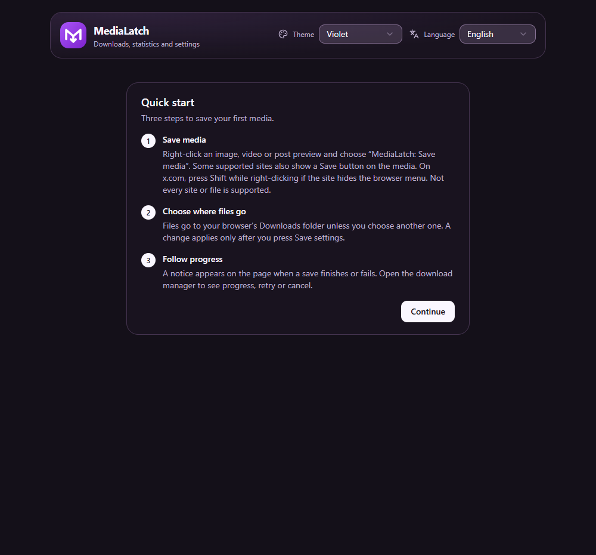
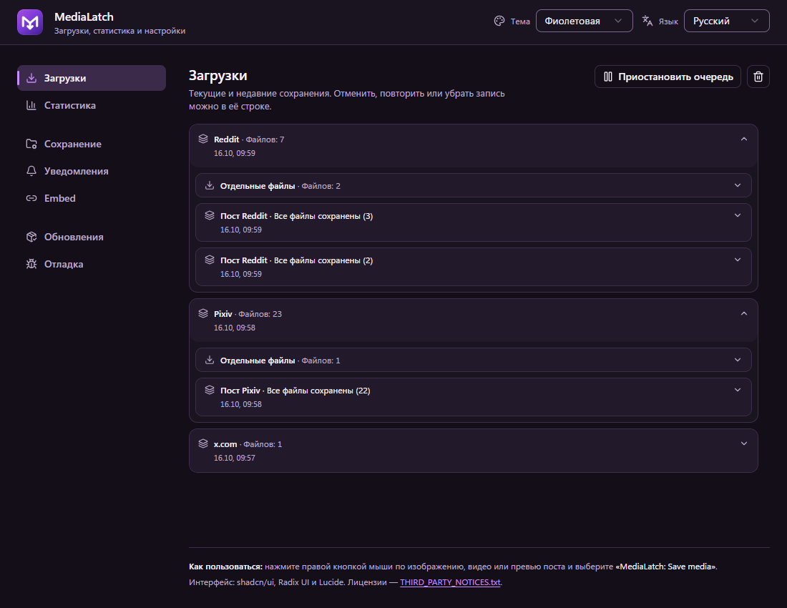
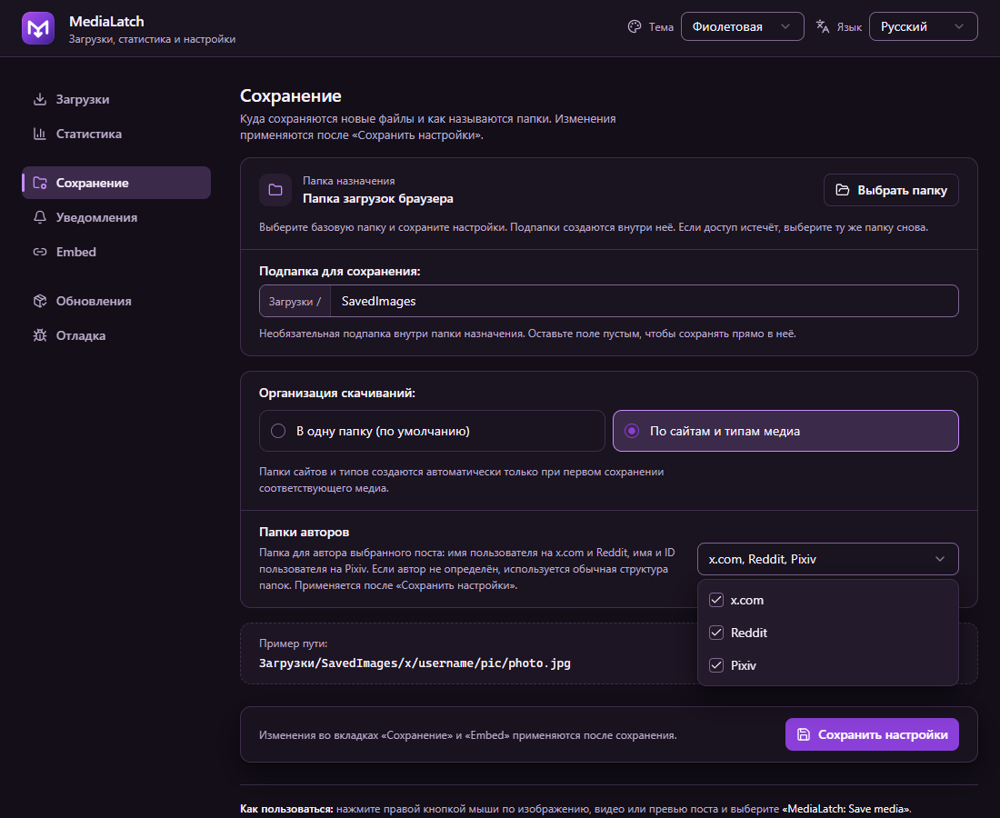
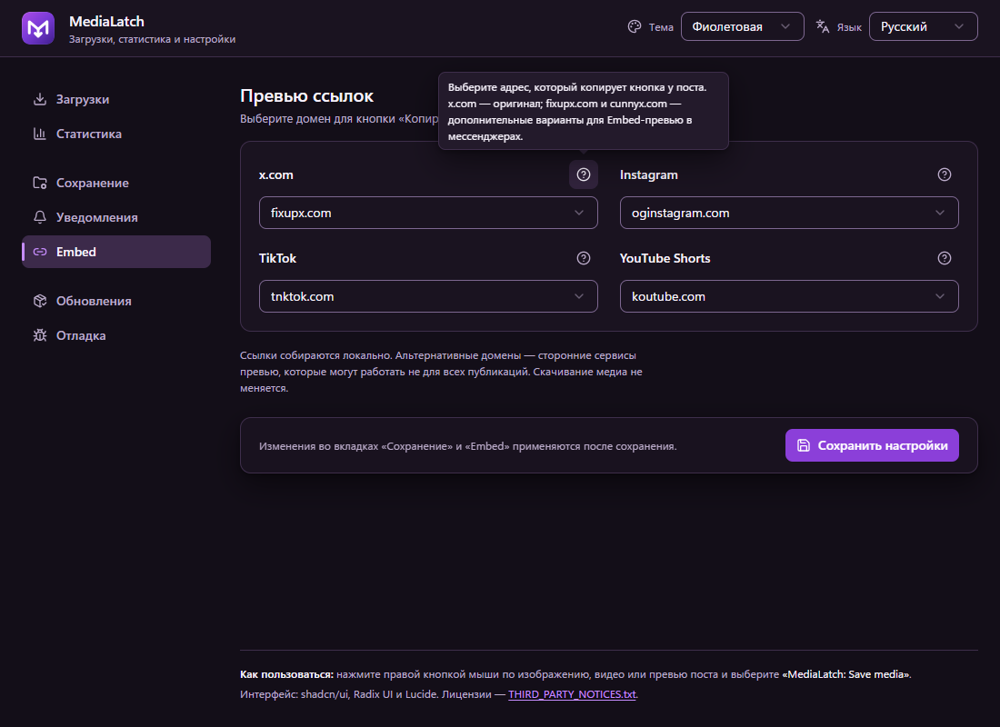

<div align="center">
  
  <h1>MediaLatch</h1>
  <p><i>«Сохраняйте доступные оригиналы прямо из браузера — изображения, видео и GIF, разложенные по вашим папкам.»</i></p>
  <p>
    <a href="https://github.com/xhthc/MediaLatch/releases/tag/v2.5.1"></a>
    
    
    
    <a href="LICENSE"></a>
  </p>
  <p>
    <a href="https://github.com/xhthc/MediaLatch/releases/tag/v2.5.1"></a>
    
    
  </p>
  <p><a href="README.md">English</a> · <a href="#быстрый-старт">Быстрый старт</a> · <a href="#установка">Установка</a> · <a href="#roadmap">Roadmap</a> · <a href="docs/PRIVACY.md">Приватность</a></p>
</div>

MediaLatch (ранее Image Saver) — расширение Chromium для сохранения доступных оригинальных изображений, видео и GIF. Нажмите ПКМ по медиа и выберите **Save media**, следите за параллельными загрузками и выбирайте, куда сохранять файлы — в том числе **в папки авторов x.com, Reddit и Pixiv**.

> **Текущий pre-release: [v2.5.1](https://github.com/xhthc/MediaLatch/releases/tag/v2.5.1).** Новый интерфейс с группами навигации, компактной сеткой превью ссылок и обновлённой фиолетовой градиентной иконкой. Сохранены синяя, тёмная и светлая темы, русский и английский языки. Дополнительный софт для сохранения не нужен.

Готовый ZIP включает новый интерфейс и ранее проверенный движок скачивания. Для этой сборки выполнены проверки UI и изолированные браузерные проверки сохранений и настроек. Предыдущие ручные проверки сайтов в Helium относятся к неизменённому движку; они не доказывают полную проверку нового UI, аудио, аварийного перезапуска или квоты.

Основная проверка проходит в Helium на Windows. Поддержка ограничена указанными ниже сценариями; разметка и правила доступа сайтов могут меняться. Firefox и выпуск в Chrome Web Store запланированы.

---

## Интерфейс

<table>
  <tr>
    <td width="50%"><br><strong>Начало в три шага</strong><br>После новой установки один раз открывается короткий экран приветствия; «Продолжить» ведёт в настройки сохранения.</td>
    <td width="50%"><br><strong>Ход каждой загрузки</strong><br>Прогресс, отмена, повтор и понятные объяснения ошибок вместе с техническим кодом.</td>
  </tr>
  <tr>
    <td width="50%"><br><strong>Куда сохранять файлы</strong><br>Папка, необязательная подпапка, папки авторов и пример пути.</td>
    <td width="50%"><br><strong>Как делиться ссылками</strong><br>Компактная сетка из четырёх списков со справкой возле платформы.</td>
  </tr>
</table>

Реальный интерфейс v2.5.1 снят в изолированном профиле Chromium. Три нейтральных общедоступных PNG из этого репозитория сохранены с проверкой полученных байтов; настройки папок выбраны для демонстрации. Приветствие показано на английском, остальные экраны — на русском. Фиолетовая тема по умолчанию; анимации учитывают уменьшение движения.

---

## Быстрый старт

1. Установите готовый архив по инструкции ниже.
2. Нажмите ПКМ по изображению, видео или поддерживаемому превью и выберите **MediaLatch: Save media**. На X попробуйте **Shift + ПКМ**, если сайт перехватывает меню.
3. Следите за загрузками в popup. **Открыть менеджер загрузок** ведёт к подробностям, отмене и повторному сохранению подготовленного файла. Уведомления MediaLatch появляются на исходной странице.
4. Откройте **Сохранение**, выберите папку и организацию, затем нажмите **Сохранить настройки**. По умолчанию используется `Загрузки/SavedImages/`.

После новой установки открывается отдельный экран приветствия из трёх коротких шагов. **Продолжить** запоминает его и открывает **Сохранение**; экран показывается только при этой первой установке, никогда после обновлений или перезапуска браузера, и кнопки обучения потом нет. «Сохранение» и «Embed» показывают **несохранённые изменения**, когда форма отличается от сохранённого (в том числе сразу после сохранения), ход сохранения, успех или постоянную ошибку; при ошибке чтения настроек есть кнопка **Повторить**. Оба менеджера загрузок объясняют ошибки понятным языком, одинаково на карточке и в подробностях, и показывают технический код отдельной строкой.

---

## Установка

1. Скачайте **готовый архив расширения** из [Releases](https://github.com/xhthc/MediaLatch/releases) и распакуйте. Выберите `MediaLatch-2.5.1-*.zip` из текущего превью; в имени архива указан исходный коммит. Автоматический Source code ZIP GitHub содержит весь репозиторий для разработки.
2. Откройте `chrome://extensions`, включите **Режим разработчика**, нажмите **Загрузить распакованное расширение** и выберите папку с `manifest.json`.
3. После замены сборки перезагрузите расширение **и обновите вкладки сайтов**.


Можно клонировать репозиторий и загрузить его корневую папку:

```bash
git clone https://github.com/xhthc/MediaLatch.git
```

Для обновления распакованного расширения замените файлы в его существующей папке, нажмите **Перезагрузить** на странице расширений браузера и обновите вкладки сайтов. Сохраните прежний путь папки, чтобы идентификатор и настройки расширения остались теми же.

Страницы `popup/` уже собраны; Node/npm нужны только для разработки. Распакованное расширение обновляется вручную. Обновления через магазины будут отдельным способом распространения.

---

## Возможности

Архив v2.5.1 включает функции ниже. Предыдущие ручные проверки в Helium покрывают заявленные сценарии Pixiv, Zerochan, X, Reddit/RedGIFs и booru; у нового интерфейса отдельные автоматические и изолированные браузерные проверки. Наблюдение в повседневном использовании продолжается.

### Сохранение выбранного медиа

- Поиск оригинала через адаптеры сайтов, ссылки, `srcset`, атрибуты медиа и однозначные CSS-фоны или перекрытия.
- Сохранение исходных изображений/GIF и доступных MP4/WebM. Объявленные ссылки, включая подписи, сохраняются точно.
- Настоящий зацикленный GIF из подтверждённых MP4-анимаций X и Reddit. Анимации длиннее 30 секунд или превышающие лимиты размера конвертации сохраняются исходным MP4; остальные ошибки преобразования отображаются явно.
- Небольшие inline-кнопки на X, Reddit и RedGIFs; ограниченные пакеты поста на X и Reddit.
- Все уникальные объявленные оригиналы поста Pawchive из превью ленты, включая оригинальную обложку. Выбор отдельного вложения сохраняет только его.

### Управление файлами

- Выбор базовой папки с правом записи и необязательной подпапки: все файлы в одну папку либо разделение по сайту и типу. Одно меню «Папки авторов» включает любое сочетание x.com, Reddit и Pixiv: username для X/Reddit, имя и ID автора для Pixiv. Результаты и отчёты об ошибках без чувствительных данных остаются в менеджере.
- Компактный popup с прокруткой колёсиком/клавиатурой, скрытым скроллбаром и общей очисткой завершённых записей. Удаление отдельных записей и подробности остаются в полном менеджере.
- Менеджер загрузок с полученным/полным размером, скоростью и примерным оставшимся временем, когда их можно измерить. Полный файл сначала сохраняется во временное локальное хранилище; повтор выдачи после ошибки не требует нового скачивания источника.

### Настройки и диагностика

- Собственные уведомления MediaLatch на исходной странице: массовые сохранения объединяются в одну карточку со счётчиками успехов и ошибок, закрытием, переходом в менеджер и общей темой. Закрытая вкладка или переход на другой сайт мешают показу; результаты и значок ошибки остаются в расширении. Уведомления об успехе отключаются отдельно.
- Фиолетовая тема по умолчанию, с выбором синей, тёмной и светлой; иконки MediaLatch в интерфейсе и панели браузера соответствуют теме. Выбор общий для popup, настроек и уведомлений; прежние предпочтения сохраняются. Короткие анимации учитывают системное уменьшение движения.
- Добровольная локальная статистика без лимита числа записей и срока, с выключателем учёта и очисткой. Сохранившаяся старая история переносится один раз; удалённые записи восстановить нельзя.
- Отключаемый локальный журнал Debug с фильтрами, копированием, экспортом и очисткой: до 2 000 событий, 1 МиБ и 24 часов. Полные ссылки, токены, текст страниц и локальные пути исключены.
- Копирование ссылок на поддерживаемые посты X, Instagram, TikTok и YouTube Shorts с выбором сервиса превью.
- Проверка релизов GitHub вручную или при открытии вкладки обновлений, не чаще раза в сутки. Автоматической установки кода расширения нет.

---

## Поддержка сайтов

| Источник | Текущее поведение |
|---|---|
| X / Twitter | Изображения/видео, подтверждённые MP4-анимации, inline-сохранение и пакеты поста |
| Reddit | Оригиналы, анимации, inline-сохранение; сборка отдельных конечных незашифрованных HLS-потоков Reddit с H.264/AAC в MP4 |
| RedGIFs | Выбранный ролик и варианты того же ролика; inline-сохранение и восстановление варианта со звуком, когда доступен |
| Pawchive | Оригиналы поста из превью или отдельного вложения; общий предел 100 файлов, интервалы запусков и остановка при ограничении запросов |
| Sankaku | Превью/уменьшенное медиа → объявленный оригинал того же поста через ПКМ в ленте/открытом посте; пользователь проверил картинки/видео в Helium, живая проверка GIF отложена |
| Booru-доски | Danbooru, Gelbooru/rule34.xxx/safebooru.org и семейство Moebooru: yande.re, Konachan, Sakugabooru. Выбранное превью/медиа поста разрешается в объявленный оригинал того же поста и файла; ограничения доступа и страницы проверки могут мешать сохранению |
| Zerochan | Выбранная миниатюра или медиа открытого поста разрешается в объявленный оригинал того же поста; недоступный оригинал приводит к отказу |
| Pixiv | Превью в ленте сохраняет объявленные оригиналы поста (до 100); выбранная картинка внутри открытого поста сохраняется отдельно |
| Другие сайты | Универсальный поиск и существующие правила, включая отдельные booru-сценарии; результат зависит от сайта |

Kemono отложен, пока сайт недоступен. Оригинал на booru берётся со страницы или из метаданных самого поста и должен совпадать по файлу (хешу) и посту; уменьшенная копия, JPEG-версия или миниатюра никогда не сохраняются как оригинал. Другие booru-сайты не обещаются. По миниатюре нельзя подтвердить оригинал. Неоднозначный элемент или недоступный источник могут привести к отказу сохранения. Ограничения поиска и подписки Sankaku соблюдаются; это превью их не обходит.

Пакеты постов X, Reddit, Pixiv и Pawchive ограничены 100 подтверждёнными элементами. После допуска выбранные медиа, состав пакета и автор остаются фиксированными при скролле или переиспользовании узлов ленты; переход на другую страницу, смена документа и недоступный плеер/фрейм могут привести к безопасному отказу. Пакет поста не скачивает всю ленту. Подготовка источников ограничена; HTTP 429 останавливает дальнейший допуск там, где это поддерживается.

---

## Использование и настройки

Нажмите ПКМ по изображению, видео или поддерживаемому превью и выберите **MediaLatch: Save media**. На X сочетание Shift + ПКМ помогает открыть меню браузера, если сайт обрабатывает нажатие сам.

Всплывающее окно показывает загрузки и этапы поиска/обработки источника. Полная страница содержит статистику, загрузки, настройки сохранения, уведомления, ссылки и релизы. По умолчанию файлы идут в `Загрузки/SavedImages/`. Организация по сайту и типу создаёт пути вроде `SavedImages/x/pic/`, `video/` и `gif/`.

Выберите **Язык** вверху полной страницы, чтобы переключиться между английским и русским. Сохранённый выбор сразу применяется к страницам расширения, уведомлениям и встроенным кнопкам. Без сохранённого выбора браузер на русском показывает русский, любой другой — английский. Пункт меню остаётся **MediaLatch: Save media** на обоих языках. Переименование сохраняет существующие настройки и папки.

Чтобы найти это превью во вкладке **Обновления**, выберите **Канал обновлений → Обычные и beta-релизы** или скачайте архив прямо из Releases. Распакованное расширение обновляется вручную.

Для диагностики включите запись в **Debug**, повторите проблему и скопируйте или экспортируйте события с нужными фильтрами. Запись начинается после включения; выключение сохраняет журнал до очистки или истечения срока хранения. Отчёты остаются локальными, пока вы сами ими не поделитесь.

В разделе **Сохранение** выберите базовую папку, необязательную подпапку и режим **Одна папка** либо **По сайту и типу медиа**, затем нажмите **Сохранить настройки**. Подпапки создаются внутри выбранной папки; без неё используется папка загрузок браузера. **Папки авторов** — одно раскрывающееся меню с независимыми галочками x.com, Reddit и Pixiv. X и Reddit используют username автора выбранного поста, Pixiv — `Имя (ID пользователя)`. Примеры: `SavedImages/x/username/pic/file.jpg` и `SavedImages/pixiv/Имя (12345)/pic/file.jpg`. Цитаты X используют своего автора; репосты Reddit, комментарии и неподтверждённый автор сохраняют обычную структуру. Прежняя настройка авторов X сохраняется.

Выбор папки требует поддержки File System Access API в браузере. Такие файлы записываются напрямую и отображаются в менеджере MediaLatch, а не в истории загрузок Chrome. Существующие файлы сохраняются: совпадающее имя получает номер. После перезапуска браузера может понадобиться снова выбрать ту же папку и сохранить настройки для возврата доступа; готовые файлы после этого можно сохранить повторно. Смена папки применяется к новым элементам очереди. При отмене записи может остаться пустой файл. Расширение получает файл в закрытое дисковое хранилище и проверяет его перед выдачей. Очередь получает до трёх файлов одновременно, максимум два с одного источника. Приостановка останавливает новые передачи, но не поиск источника или уже начатую передачу. Для неизвестного размера проценты и оставшееся время не выдумываются. Обработка сохраняет прежние ограничения ресурсов GIF/HLS.

После ошибки выдачи готовые байты остаются для явного повтора; удаление записи очищает временный файл, а не скачанный вами. Прерванное получение при повторе начинается заново по точной ссылке; продолжение частичной передачи не обещается. После перезапуска расширение сверяет свои сохранения браузера и не запускает дубликаты. Устаревший выбор или источник могут потребовать нового клика на сайте. Подробности и отчёты остаются на полной странице загрузок.

---

## Ограничения и приватность

DRM, обход доступа, произвольные blob/MSE-плееры и универсальная загрузка HLS/DASH не поддерживаются. Отдельные звуковые дорожки объединяются только в поддерживаемом сценарии Reddit HLS. Отсутствующие файлы и ограничения сайтов нельзя гарантированно устранить. Очень быстрые inline-сохранения RedGIFs могут упереться во внутренний предел четырёх одновременно подготавливаемых сохранений до очереди передачи. Текущий код `RATE_LIMIT` также используется для ответа HTTP 429 сайта/CDN; дождитесь окончания активной подготовки и повторите сохранение.

GIF: вход до 50 МиБ, длительность до 30 секунд, 150 кадров, 640 px, выход до 15 МиБ и время до 45 секунд. Изображения Pixiv ограничены 50 МиБ по объявленному и фактически полученному размеру; их загружает менеджер загрузок с прогрессом и тайм-аутом простоя вместо 20-секундного предела на всю передачу. Это пределы отдельных обработчиков, а не всех прямых загрузок.

Телеметрии и сервера расширения нет. Учёт статистики и запись Debug изначально выключены, отчёты копируются или экспортируются по запросу. Поиск и сохранение обращаются к сайтам/CDN, проверка релизов — к GitHub. Подробнее — в [политике приватности](docs/PRIVACY.md).

---

## Roadmap

Статусы отделяют реализованные функции от будущих задач. Они задают направление, а не сроки или обещание поддержки любой разметки. Сначала надёжность; для каждой функции нужны отдельная реализация и проверка в браузере.

| Направление | Планируемый результат | Статус |
|---|---|---|
| Booru и универсальный поиск | Проверенные общие правила оригиналов/владения медиа для изученных движков; улучшение выбранного медиа и результатов Яндекс/Google Картинок | Семейства booru включены в превью; ручные проверки изученных досок пройдены, ограничения доступа/разметки остаются; поиск картинок запланирован |
| Кнопки и выделение | Маленькие универсальные inline-кнопки и отключаемое выделение нескольких постов/медиа | Запланировано |
| Менеджер загрузок | Дополнить работающую очередь файлов последовательным поиском источников постов, итогами пакетов и проверенным продолжением передачи | Очередь файлов включена в превью; остальное запланировано |
| Подготовка полного файла | Получение/проверка на диске до выдачи и локальный повтор; расширить проверки перезапуска, квоты и медиа в браузере | Включено в превью; обычные проверки в Helium пройдены, стресс-проверки ожидаются |
| Пакеты и архивы | Выбранные посты/страница, сначала ZIP; 7z только при оправданной реализации с ограниченными ресурсами | Запланировано |
| Папки и имена | Базовая папка, единая структура или разделение по сайту/типу, папки авторов x.com/Reddit/Pixiv | Включено; пользователь проверил единую папку и папки авторов в Helium; более широкие проверки восстановления доступа остаются |
| Kemono | Объявленные оригиналы своего поста и отдельные сценарии ленты | Отложено до восстановления сайта |
| Публикация по желанию | Отдельные редакторы VK/Telegram, предпросмотр и явная отправка, затем расписание и восстановление без дублей | Позже; авторизация, токены и надёжный планировщик требуют отдельного проекта |
| Браузеры и распространение | Другие Chromium, порт Firefox, Chrome Web Store и обновления через магазин | Запланировано; сначала безопасность/приватность |
| Настройки и документация | Компактные группы настроек, быстрый старт со скриншотами и README EN/RU | Включено; ручная проверка относилась к предыдущему UI, новый проверен отдельно в изолированном браузере |
| Первое включение | Одноразовый экран приветствия из трёх шагов, «Продолжить» ведёт в «Сохранение»; состояния сохранения настроек; понятные ошибки загрузок и повтор чтения списка | Включено; новая установка проверена в изолированном браузере; сообщение пользователя относилось к предыдущему UI |

Roadmap Telegram/VK касается **публикации**.

---

## Безопасность перед выпуском в магазине

До подачи в магазин: проверки кода/CSP в архиве, отправителя/действия/фрейма сообщений, URL/перенаправлений и локальной сети, минимальных разрешений, зависимостей/целостности релиза, повреждённых медиа и исчерпания ресурсов. Широкий доступ к HTTP/HTTPS требует отдельного внимания. Это **план готовности, а не завершённый аудит или одобрение магазином**. Исполняемый код поставляется локально; проверка релизов читает метаданные и не устанавливает код.

Подробнее: [безопасность](docs/SECURITY.md), [приватность](docs/PRIVACY.md) и [подготовка релиза](docs/RELEASE.md).

---

## Разработка

```text
MediaLatch/
├─ manifest.json
├─ background.js
├─ offscreen.html / offscreen.js
├─ content/                 Скрипты сайтов
├─ lib/
│  ├─ worker/              Модули фонового worker
│  └─ vendor/              Сторонние модули и лицензии
├─ ui/                     Исходники интерфейса
├─ popup/                  Готовая сборка интерфейса
├─ tests/
│  ├─ fixtures/
│  │  ├─ generic-media/    Тестовые изображения и видео
│  │  └─ reddit/           Снимки структур Reddit
│  ├─ cases/
│  └─ helpers/
├─ tools/
│  └─ fixtures/            Тестовые серверы и генераторы
├─ docs/
│  └─ assets/              Скриншоты и графика README
└─ icons/                  Иконка и варианты тем
```

Корень распакованного расширения остаётся прежним. `background.js` загружает `lib/worker/` одним упорядоченным блоком. Общие правила обработки медиа находятся в `lib/`, скрипты сайтов — в `content/`. Правьте `ui/` и генерируйте `popup/`. Тестовые данные и серверы используются только при разработке и не входят в архив расширения.

Проверка локальных медиа: `node tools/fixtures/generic-media-server.js --self-check`; без флага запускается сервер. [Происхождение тестовых файлов](tests/fixtures/generic-media/avif/README.md).


Нужен Node.js, совместимый с UI lockfile. Текущие проверки также выполняются на Node.js 24.19.

```bash
npm ci --prefix ui
npm run build --prefix ui
node tools/verify.mjs --ui
node tools/package.mjs HEAD
```

Правьте `ui/` и пересобирайте `popup/`. Проверки включают регрессии, типы, рендеринг и совпадение исходников UI со сборкой. Звук, воспроизведение и скачанные байты проверяются отдельно в браузере. Упаковка берёт принятый Git-коммит и создаёт архив с SHA, версией и хешем в `local-notes/releases/`.

[Архитектура](docs/ARCHITECTURE.md) · [Подготовка релиза](docs/RELEASE.md) · [Изменения](CHANGELOG.md)

[Тесты](tests/test_suite.js): основной набор можно запустить отдельно командой `node tests/test_suite.js`.

---

## Лицензия

Собственный код — **GPL-3.0-only**. Сторонний код и графические символы сохраняют свои лицензии: [общие уведомления](THIRD_PARTY_NOTICES.txt), [UI](popup/THIRD_PARTY_NOTICES.txt) и [MP4Box](lib/vendor/mp4box/2.4.1/LICENSE).
